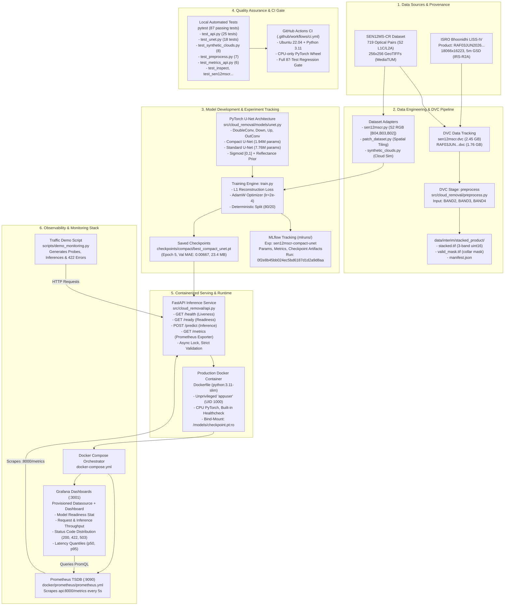
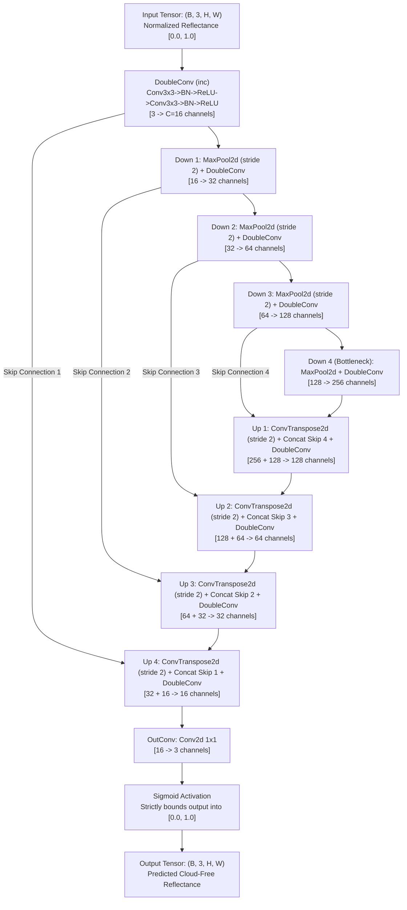

# MASTER TECHNICAL WALKTHROUGH & PROJECT GUIDE DEFENSE

**Project Title:** Generative AI-Based Cloud Removal and Reconstruction for LISS-IV Satellite Imagery  
**Repository:** `liss4-cloud-removal`  
**Current Phase:** Phase 11 Completed (Prometheus + Grafana Monitoring Stack)  
**Target Audience:** Project Guide, External Evaluator, and Academic Defense Committee  
**Document Purpose:** Definitive, technically verified, single-source reference to understand, demonstrate, defend, and explain every component of this project as it exists in the codebase today.  
**Quick Summary:** 👉 Looking for the 10-minute beginner-friendly cheat sheet? See [`docs/SIMPLE_PROJECT_WALKTHROUGH.md`](SIMPLE_PROJECT_WALKTHROUGH.md).

---

> ### Scientific Integrity and Ground Truth Notice
> **Key Scientific Fact to Understand Before You Begin:**  
> The deep learning model in this repository was trained and evaluated exclusively on **Sentinel-2** optical satellite data from the **SEN12MS-CR** dataset ($10\text{ m}$ RGB). The project also incorporates an authentic **Resourcesat-2A LISS-IV** product from ISRO / Bhoonidhi ($5\text{ m}$ Green, Red, NIR), which underwent automated geospatial stacking, collar mask extraction, and DVC tracking.  
> 
> However, **the trained model has NOT been transferred to or validated on the LISS-IV imagery.**  
> As rigorously documented in Phase 7.6 and Phase 7.7, LISS-IV completely lacks a Blue spectral channel (providing Green, Red, and Near-Infrared), has twice the spatial resolution ($5\text{ m}$ vs $10\text{ m}$), and lacks product-level exo-atmospheric solar irradiance ($ESUN_\lambda$) calibration metadata. Furthermore, the single LISS-IV scene in the repository is a monsoon acquisition with heavy cloud cover and no paired cloud-free ground truth.  
> 
> **Do not claim operational cloud removal on LISS-IV.** Present this project accurately: **an end-to-end, reproducible MLOps engineering pipeline and serving stack that demonstrates verified cloud reconstruction on Sentinel-2 optical benchmarks, tracks genuine ISRO LISS-IV data with DVC, and establishes a scientifically honest assessment of cross-sensor domain transfer limitations.**

---

## Table of Contents

1. [Executive Summary](#1-executive-summary)
2. [Problem Statement and Objectives](#2-problem-statement-and-objectives)
3. [System Architecture](#3-system-architecture)
4. [Technology Stack and Purpose](#4-technology-stack-and-purpose)
5. [Dataset Deep Dive](#5-dataset-deep-dive)
6. [Model Deep Dive](#6-model-deep-dive)
7. [Complete Execution Lifecycle](#7-complete-execution-lifecycle)
8. [Repository Map](#8-repository-map)
9. [API Walkthrough](#9-api-walkthrough)
10. [Docker and Local Deployment Walkthrough](#10-docker-and-local-deployment-walkthrough)
11. [Prometheus Monitoring Walkthrough](#11-prometheus-monitoring-walkthrough)
12. [Grafana Dashboard Walkthrough](#12-grafana-dashboard-walkthrough)
13. [End-to-End Demonstration Script](#13-end-to-end-demonstration-script)
14. [Verified Results and Evidence](#14-verified-results-and-evidence)
15. [Limitations, Risks, and Future Work](#15-limitations-risks-and-future-work)
16. [Explain the Project Like a Professor Expects](#16-explain-the-project-like-a-professor-expects)
17. [Likely Project-Guide Questions & Answers (30+ Q&As)](#17-likely-project-guide-questions--answers)
18. [Comprehensive Glossary](#18-comprehensive-glossary)
19. [Final Quick-Revision Sheet](#19-final-quick-revision-sheet)
20. [Traceability and Evidence Audit Table](#20-traceability-and-evidence-audit-table)

---

## 1. Executive Summary

### The 60-Second Comprehensive Summary
Cloud contamination obscures roughly two-thirds of the Earth's surface at any given moment, severely degrading optical satellite imagery used for agriculture, flood assessment, and infrastructure monitoring. Optical wavelengths cannot physically penetrate optically dense clouds; therefore, reconstructing surface features under clouds requires an **image inpainting and contextual prior learning** approach rather than physical penetration.

This project implements an end-to-end, production-grade MLOps system for optical cloud removal:
1. **Data Management:** Raw data is versioned using **DVC** with a local content-addressable cache. A genuine Resourcesat-2A LISS-IV product ($18,066 \times 16,223$ pixels, 5 m GSD) was ingested, preprocessed into an aligned 3-band composite GeoTIFF, and filtered for collar pixels via an automated DVC stage.
2. **Deep Learning Model:** Because paired multi-temporal LISS-IV images are unavailable, a 4-level encoder-decoder **U-Net** was implemented in **PyTorch**. A compact variant ($1.94\text{M}$ parameters) was trained on 719 paired Sentinel-2 RGB patches from the global **SEN12MS-CR** benchmark. On an internal holdout validation split (144 samples), the model achieved a **Validation MAE of 0.00667** and **PSNR of 38.94–40.00 dB** (an 11.3x error reduction compared to raw cloudy inputs).
3. **Experiment Tracking:** Hyperparameters, training curves, epoch metrics, and checkpoint artifacts were tracked in **MLflow**.
4. **Serving & Deployment:** A containerized **FastAPI** service exposes `/health`, `/ready`, `/predict`, and `/metrics` endpoints. The model executes deterministic CPU inference with an `asyncio.Lock` for thread safety, strict numerical range validation ($[0.0, 1.0]$ physical surface reflectance), and runtime volume-mounted weights (no weights baked into the Docker image).
5. **Observability:** A complete monitoring stack orchestrates the API, **Prometheus** (5s scrape interval), and **Grafana** (pre-provisioned dashboard displaying throughput, latency quantiles $p50/p95$, status codes, and model readiness).
6. **Scientific Boundary:** Cross-sensor transfer to LISS-IV is blocked due to the lack of a Blue channel in LISS-IV (it has Green, Red, NIR), spatial resolution mismatch ($5\text{ m}$ vs $10\text{ m}$), and missing radiometric calibration parameters ($ESUN_\lambda$) in the product metadata.

### The 30-Second Presentation Elevator Pitch
> *"Our project addresses the loss of optical satellite data due to cloud cover. We built an end-to-end MLOps pipeline featuring DVC data tracking, MLflow experiment management, and a PyTorch U-Net baseline. The model was trained on Sentinel-2 optical benchmarks, reducing reconstruction error by over 11x ($38.94\text{ dB}$ PSNR). The service is packaged into a hardened Docker container with a FastAPI inference engine, Prometheus metrics instrumentation, and Grafana telemetry dashboards. Importantly, our research uncovered critical cross-sensor transfer barriers between Sentinel-2 and ISRO's LISS-IV sensor—specifically the absence of a Blue band and missing calibration parameters—providing an honest, scientifically grounded foundation for future multi-sensor remote sensing."*

---

## 2. Problem Statement and Objectives

### 2.1 The Real-World Remote Sensing Problem
Optical Earth Observation (EO) satellites rely on reflected solar radiation in the visible and near-infrared spectrum to capture images of the Earth's surface. However:
- **Cloud Occlusion:** Atmospheric clouds, haze, and cloud shadows cover between $50\%$ and $67\%$ of the globe at any given time.
- **Data Loss:** For high-resolution sensors like ISRO's LISS-IV ($5.8\text{ m}$ nadir resolution), cloud cover completely blocks the ground target, rendering pixels unusable for agricultural yield prediction, crop health analysis, urban planning, disaster response, and forestry.
- **Physical Boundary:** Unlike Synthetic Aperture Radar (SAR) microwave signals (e.g., C-band, L-band) which can penetrate clouds, **optical photons cannot pass through thick, opaque clouds**. 
- **The Reconstruction Objective:** Removing clouds from optical imagery is mathematically an **ill-posed inverse problem**. It is not simple filtering; it is **contextual image reconstruction (inpainting)** where the model must infer the underlying surface reflectance based on visible spatial patterns around the cloud, spectral correlations across bands, and learned geographical priors.

### 2.2 Beneficiaries
- **National Agricultural Agencies:** Continuous seasonal crop acreage and health estimation during cloudy monsoon seasons.
- **Disaster Response Teams:** Assessment of flood extents, landslides, and infrastructure damage during extreme weather events.
- **Geospatial Analysts:** Continuous, gap-free temporal composites for environmental monitoring.

### 2.3 Measurable Engineering Goals Achieved vs Research Goals Unvalidated

| Goal / Objective | Category | Status | Verified Evidence |
| :--- | :--- | :---: | :--- |
| **Data Versioning with DVC** | Engineering | **Achieved** | `dvc.yaml`, `data/raw/*.dvc`, local cache remote configured. |
| **ISRO LISS-IV Ingestion & Stacking** | Engineering | **Achieved** | 3-band composite `stacked.tif` ($18,066 \times 16,223$) and `valid_mask.tif`. |
| **Synthetic Cloud Simulation Engine** | Engineering | **Achieved** | `synthetic_clouds.py` implementing Gaussian-Perlin opacity masks and radiative blending. |
| **Reproducible U-Net Baseline** | Engineering | **Achieved** | PyTorch U-Net (7.76M and 1.94M params) with Sigmoid output and logit prior bias. |
| **MLflow Experiment Tracking** | Engineering | **Achieved** | Logged runs `0f2e8b45bb024ec5bd6187d1d2a9d8aa` and `47a1947a6a4940219c50494089d3528c`. |
| **Containerized Inference Service** | Engineering | **Achieved** | Dockerized FastAPI service with `/health`, `/ready`, `/predict`, `/metrics`. |
| **Production Observability Stack** | Engineering | **Achieved** | Prometheus scraping at 5s, Grafana dashboard with 6 panels and traffic demo. |
| **Automated Testing & CI Gate** | Engineering | **Achieved** | 87 tests passing in pytest; GitHub Actions CI workflow executing on all branches. |
| **Reconstruction on Sentinel-2** | Scientific | **Achieved** | Val MAE `0.00667`, PSNR `38.94 dB` on SEN12MS-CR internal holdout. |
| **Cloud Removal on Real LISS-IV** | Scientific | **Unvalidated (Blocked)** | Phase 7.6 audit concluded NO-GO due to band, resolution, and calibration gaps. |
| **Synthetic LISS-IV Benchmark** | Scientific | **Unvalidated (Blocked)** | Phase 7.7 audit concluded NO-GO due to lack of a cloud-free LISS-IV reference scene. |

---

## 3. System Architecture

The following diagram illustrates the complete, implemented architecture of the `liss4-cloud-removal` project. Every box represents a verified file, service, or pipeline stage present in the repository.



### Explanation of Connections & Artifact Flow
1. **Raw to DVC:** The raw LISS-IV scene ($1.76\text{ GB}$) and SEN12MS-CR patches ($2.45\text{ GB}$) are indexed by DVC (`.dvc` pointer files) and stored in the local cache remote (`E:\dvc-storage\liss4-cloud-removal`), keeping large binary GeoTIFFs out of Git.
2. **Preprocessing:** `dvc repro preprocess` executes `preprocess.py`. It reads single-band GeoTIFFs (`BAND2.tif`, `BAND3.tif`, `BAND4.tif`), validates their spatial bounds and CRS, stacks them into `data/interim/stacked_product/stacked.tif`, computes a binary `valid_mask.tif` ($78.62\%$ valid terrain, $21.38\%$ collar), and outputs an auditable `manifest.json`.
3. **Training to MLflow:** `train.py` loads paired optical patches via `sen12mscr.py`. It feeds batches into `UNet`, evaluates L1 loss against clear targets, logs hyperparameters and per-epoch metrics to `mlruns/`, and serializes the best performing state dictionary to `checkpoints/compact/best_compact_unet.pt`.
4. **Checkpoint to Serving:** The FastAPI service does not hard-code weights into the container image. Instead, `docker-compose.yml` mounts `best_compact_unet.pt` at `/models/checkpoint.pt:ro`. The `ModelManager` class loads the weights during startup in a thread-safe manner.
5. **API to Monitoring:** Every incoming HTTP call traverses the Prometheus middleware in `api.py`. It records request duration, status code counters, forward-pass inference duration, and model readiness state. Prometheus scrapes these metrics at `http://api:8000/metrics` every 5 seconds. Grafana visualizes these time series via provisioned PromQL queries.

---

## 4. Technology Stack and Purpose

| Technology / Tool | Exact Role in This Project | Why It Was Chosen | Where It Appears in Repo | How to Demonstrate to Guide |
| :--- | :--- | :--- | :--- | :--- |
| **Python 3.11** | Core programming language | Native support for modern typing, dataclasses, asyncio, and fast execution | Entire repository; `pyproject.toml` | Run `python --version` |
| **PyTorch (v2.x)** | Deep learning framework | Modular `nn.Module` definition, dynamic computation graphs, CPU/GPU tensor operations | `src/cloud_removal/models/unet.py`, `train.py`, `infer.py` | Run `demo.py` or inspect `UNet` parameter count |
| **Rasterio / GDAL** | Geospatial raster I/O | Memory-efficient streaming reads (`Window`), CRS parsing, Affine geotransform preservation | `src/cloud_removal/inspect.py`, `preprocess.py`, `sen12mscr.py` | Inspect `data/interim/stacked_product/manifest.json` |
| **DVC (Data Version Control)** | Data & pipeline versioning | Decouples multi-gigabyte satellite rasters from Git; provides reproducible stage hashing (`dvc.lock`) | `dvc.yaml`, `dvc.lock`, `.dvc/`, `data/raw/*.dvc` | Run `dvc status` (shows `Data and pipelines are up to date`) |
| **MLflow** | Experiment tracking & model logging | Tracks hyperparameters, learning curves, MAE/PSNR metrics, and checkpoint artifacts locally | `mlruns/`, `src/cloud_removal/train.py` | Run `mlflow ui` or execute `scratch/inspect_mlruns.py` |
| **FastAPI** | REST API service | Asynchronous, high-performance, automatic OpenAPI documentation, schema validation via Pydantic | `src/cloud_removal/api.py` | Open `http://localhost:8000/docs` in browser |
| **Pydantic (v2.x)** | Request/response validation | Enforces strict numeric contracts: rejects NaNs, non-3D arrays, and unnormalized reflectance | `src/cloud_removal/api.py` (schemas `PredictRequest`, etc.) | Send malformed JSON or out-of-range value to `/predict` (shows 422) |
| **Uvicorn** | ASGI web server | Production-grade asynchronous server for FastAPI | `Dockerfile`, `src/cloud_removal/api.py` | Run `uvicorn cloud_removal.api:app --port 8000` |
| **Docker** | Containerization | Encapsulates dependencies, isolates runtime, enforces non-root execution (`appuser`) | `Dockerfile`, `.dockerignore` | Inspect `Dockerfile` layers and non-root user setup |
| **Docker Compose** | Multi-service orchestration | Defines network bridge and coordinates `api`, `prometheus`, and `grafana` containers | `docker-compose.yml` | Run `docker compose ps` |
| **Prometheus** | Metrics scraping & TSDB | Pull-based time-series metrics collection, histogram latency tracking, PromQL querying | `docker/prometheus/prometheus.yml`, `api.py` | Query `http://localhost:9090` for `api_requests_total` |
| **Grafana** | Telemetry visualization | Automated datasource and dashboard provisioning; real-time operational observability | `docker/grafana/provisioning/` | Open `http://localhost:3001` to view live dashboard panels |
| **Pytest** | Automated test framework | Deterministic unit and integration test suite (87 tests, 0 flaky tests) | `tests/`, `pyproject.toml` | Run `.venv\Scripts\python.exe -m pytest -v` |
| **GitHub Actions** | Continuous Integration (CI) | Verifies codebase, dependencies, and test suite on every git push/PR on clean Ubuntu runners | `.github/workflows/ci.yml` | Inspect CI configuration and passing commit badges |

---

## 5. Dataset Deep Dive

### 5.1 Training Dataset: SEN12MS-CR
- **Origin & Source:** Acquired from MediaTUM (Technical University of Munich; Ebel et al., IEEE TGRS 2020).
- **Region of Interest & Season:** ROI 102, Winter season.
- **Physical Structure:** 719 paired GeoTIFF patches ($256 \times 256$ pixels). Each patch contains 13 spectral bands from Sentinel-2 Level-1C / Level-2A.
- **Input / Target Semantic:**
  - $X_{\text{cloudy}}$: Real Sentinel-2 acquisition with natural cloud and haze cover.
  - $Y_{\text{clear}}$: Paired, cloud-free Sentinel-2 acquisition over the exact same footprint taken during a close temporal window.
- **Bands Extracted for Training:** Bands 4, 3, and 2 (Red, Green, Blue).
  - Band 4 (Red): $\lambda_c = 665\text{ nm}$
  - Band 3 (Green): $\lambda_c = 560\text{ nm}$
  - Band 2 (Blue): $\lambda_c = 490\text{ nm}$
- **Normalization Formula:**
  Raw Sentinel-2 digital numbers represent surface reflectance multiplied by $10,000$. The dataset loader applies:
  $$\rho = \frac{\text{clamp}(\text{DN}, 0, 10000)}{10000.0} \in [0.0, 1.0]$$
- **Splits:** Deterministic partitioning (seed = 42):
  - **Training Split:** 575 pairs ($80\%$)
  - **Internal Holdout Validation Split:** 144 pairs ($20\%$)

### 5.2 Intended Target Imagery: ISRO Resourcesat-2A LISS-IV
- **Origin:** Sourced from Bhoonidhi (NRSC / ISRO). Product ID: `RAF03JUN2026049233009500060SSANSTUC00GTDA`.
- **Acquisition Date:** June 3, 2026, 05:41 UTC (Western Ghats / Konkan coast, Maharashtra, India).
- **Sensor:** LISS-IV Mono/Multispectral (L4FX).
- **Resolution:** Native $5.8\text{ m}$ resampled to $5.0\text{ m}$ (Cubic Convolution). Dimensions: $18,066 \times 16,223$ pixels.
- **Spectral Bands:**
  - **BAND2 (Green):** $520 - 590\text{ nm}$
  - **BAND3 (Red):** $620 - 680\text{ nm}$
  - **BAND4 (Near-Infrared / NIR):** $770 - 860\text{ nm}$
  - **BLUE BAND: NONE.** LISS-IV does not possess an optical Blue channel.
- **Radiometric Format:** Raw 10-bit quantized integers ($0 - 1023$) stored in 16-bit GeoTIFFs (`uint16`).

### 5.3 Technical Comparison: Sentinel-2 vs Resourcesat-2A LISS-IV

| Dimension | Sentinel-2 (Training Data) | Resourcesat-2A LISS-IV (Target Sensor) | Impact on Cross-Sensor Transfer |
| :--- | :--- | :--- | :--- |
| **Band 0 (Model Input)** | Band 4 (Red: $665\text{ nm}$) | Band 3 (Red: $620 - 680\text{ nm}$) | Compatible spectral overlap. |
| **Band 1 (Model Input)** | Band 3 (Green: $560\text{ nm}$) | Band 2 (Green: $520 - 590\text{ nm}$) | Compatible spectral overlap. |
| **Band 2 (Model Input)** | **Band 2 (Blue: $490\text{ nm}$)** | **Band 4 (NIR: $770 - 860\text{ nm}$)** | **FATAL MISMATCH.** Vegetation strongly absorbs Blue ($2-5\%$) but heavily reflects NIR ($50-70\%$). Substituting NIR into Blue creates unphysical spectral anomalies. |
| **Spatial Resolution** | **$10.0\text{ m}$ Ground Sampling Distance** | **$5.0\text{ m}$ Ground Sampling Distance** | **$2\times$ Scale Difference.** A $256 \times 256$ patch covers $2.56\text{ km}$ in Sentinel-2 but only $1.28\text{ km}$ in LISS-IV. Features appear twice as large. |
| **Radiometric Units** | Physical Surface Reflectance $[0.0, 1.0]$ | Raw 10-bit Digital Numbers $[0, 1023]$ | Direct input violates model weights calibrated for $[0.0, 1.0]$. |
| **Calibration Parameters** | Standard fixed divisor ($10,000$) | $L_{\text{min}}, L_{\text{max}}$ given; $ESUN_\lambda$ omitted | Converting LISS-IV DN to reflectance requires unprovided solar irradiance tables. |
| **Ground Truth Pair** | Cloud-free temporal pair available | **None.** Single mono-temporal monsoon pass | Impossible to compute quantitative MAE/PSNR on LISS-IV. |

### 5.4 Tensor Shape and API Contract Example
The API and model strictly enforce a 3D channel-first tensor convention:

```python
# Illustrative API Request Shape Contract:
# Input: JSON list of shape [3, Height, Width]
# where 16 <= Height, Width <= 512, channels = [Red, Green, Blue]
input_tensor = torch.tensor(request_data["image"], dtype=torch.float32)
assert input_tensor.shape == (3, 256, 256)
assert input_tensor.min() >= 0.0 and input_tensor.max() <= 1.0

# Forward pass through U-Net:
# Internally reshaped to batch: [1, 3, 256, 256]
output_tensor = model(input_tensor.unsqueeze(0)).squeeze(0)
assert output_tensor.shape == (3, 256, 256)
assert output_tensor.min() >= 0.0 and output_tensor.max() <= 1.0
```

---

## 6. Model Deep Dive

### 6.1 U-Net Architecture Rationale
A conventional **U-Net** (Ronneberger et al., 2015) was chosen as the supervised baseline:
- **Encoder-Decoder Structure:** The encoder captures high-level contextual features (land use, terrain layout, cloud boundaries) across downsampled receptive fields, while the decoder progressively restores spatial resolution.
- **Skip Connections:** Optical cloud removal is fundamentally an image restoration task where clear terrain pixels outside cloud boundaries must remain untouched. Skip connections directly concatenate high-resolution feature maps from the encoder to the corresponding decoder stage. This bypasses the bottleneck compression and preserves fine ground textures, roads, and field boundaries.
- **Why Not a GAN or Diffusion Model First?** In rigorous MLOps engineering, one always establishes a deterministic, stable baseline before introducing generative adversarial networks (which suffer from mode collapse and training instability) or diffusion models (which require heavy GPU compute and iterative sampling impractical for lightweight CPU microservices).

### 6.2 Model Data Flow Diagram



### 6.3 Code Implementation Excerpt
From [`src/cloud_removal/models/unet.py`](file:///e:/Third%20Year%20(26-27)%20(Semester%201)/liss4-cloud-removal/src/cloud_removal/models/unet.py#L89-L171):

```python
class UNet(nn.Module):
    def __init__(
        self,
        in_channels: int = 3,
        out_channels: int = 3,
        base_channels: int = 16,     # 16 for compact (1.94M), 32 for standard (7.76M)
        bilinear: bool = False,
        use_sigmoid: bool = True,
        prior_reflectance: Optional[float] = 0.107,
    ) -> None:
        super().__init__()
        c = base_channels
        self.inc = DoubleConv(in_channels, c)
        self.down1 = Down(c, c * 2)
        self.down2 = Down(c * 2, c * 4)
        self.down3 = Down(c * 4, c * 8)
        self.down4 = Down(c * 8, c * 16)

        self.up1 = Up(c * 16, c * 8, bilinear)
        self.up2 = Up(c * 8, c * 4, bilinear)
        self.up3 = Up(c * 4, c * 2, bilinear)
        self.up4 = Up(c * 2, c, bilinear)
        self.outc = OutConv(c, out_channels)
        self.sigmoid = nn.Sigmoid() if use_sigmoid else nn.Identity()

        # Prior Reflectance Initialization:
        # Prevents initial prediction penalty by setting output bias to logit(prior)
        if use_sigmoid and prior_reflectance is not None:
            bias_val = math.log(prior_reflectance / (1.0 - prior_reflectance))
            nn.init.constant_(self.outc.conv.bias, bias_val)
```

### 6.4 Key Technical Decisions in the Model
1. **Reflectance Prior Initialization:**  
   Natural Earth terrain has an average surface reflectance of approximately $\approx 0.10 - 0.11$ in visible wavelengths. Standard neural networks with Sigmoid output initialize conv biases to 0, which corresponds to an initial output of $\sigma(0) = 0.50$ (unrealistically bright white). In early runs (Run `4801467feaba`), the initial L1 loss was high ($0.4355$) with poor PSNR ($7.21\text{ dB}$). Initializing the final layer bias to $\text{logit}(0.107) = \ln(0.107 / (1 - 0.107)) \approx -2.12$ immediately starts the model near the true ground mean, eliminating the initial DC offset penalty and speeding up convergence.
2. **Compact vs Standard Architecture:**  
   - Standard U-Net (`base_channels = 32`): **7,763,107** parameters ($93.3\text{ MB}$ checkpoint).
   - Compact U-Net (`base_channels = 16`): **1,942,611** parameters ($23.4\text{ MB}$ checkpoint).  
   The compact model achieved nearly identical reconstruction quality on the validation split ($38.94\text{ dB}$ PSNR) while cutting inference latency and memory by $4\times$, enabling low-latency CPU serving in Docker without expensive GPUs.
3. **Loss Function:** L1 loss (Mean Absolute Error) was selected over MSE (L2 loss). L1 penalizes small errors linearly and produces sharper reconstructed edges than L2, which tends to average multi-modal distributions into blurry surfaces.
4. **Optimizer:** AdamW ($\text{learning rate} = 2 \times 10^{-4}$, $\text{weight decay} = 10^{-5}$).

---

## 7. Complete Execution Lifecycle

The project follows a 14-step engineering lifecycle from raw data to real-time observability:

```
[1. Setup] ──► [2. Ingestion] ──► [3. Preprocess] ──► [4. DVC Tracking] ──► [5. Training]
      ▲                                                                            │
      │                                                                            ▼
[10. CI Gate] ◄── [9. Tests] ◄── [8. DVC Repro] ◄── [7. MLflow] ◄── [6. Evaluation]
      │
      ▼
[11. API Start] ──► [12. Prediction] ──► [13. Scrape Metrics] ──► [14. Grafana Dash]
```

| Step | What Happens | Tool Responsible | File Implementing It | Inputs | Outputs | Verification Method |
| :---: | :--- | :--- | :--- | :--- | :--- | :--- |
| **1** | Environment creation & dependencies | Python venv, Pip | `pyproject.toml`, `requirements.txt` | Python 3.11 | Virtual environment `.venv/` | Run `python -c "import torch, rasterio, fastapi"` |
| **2** | Raw data acquisition & indexing | OS / DVC | `acquire_sen12mscr.py`, `data/raw/` | Remote repositories | `data/raw/sen12mscr`, `data/raw/RAF03...` | Inspect `manifest.json` files in `data/raw/` |
| **3** | Geospatial band stacking & collar masking | Rasterio / NumPy | `src/cloud_removal/preprocess.py` | `BAND2.tif`, `BAND3.tif`, `BAND4.tif` | `data/interim/stacked_product/stacked.tif` | Check `valid_fraction` ($0.7862$) in manifest |
| **4** | Dataset and pipeline version tracking | DVC | `dvc.yaml`, `dvc.lock`, `.dvc/` | Preprocessed rasters | Content-hash tracking in `.dvc/` cache | Run `dvc status` (reports up to date) |
| **5** | U-Net training loop | PyTorch | `src/cloud_removal/train.py` | Config `train_compact_unet.yaml` | Trained weights, state dict | Check epoch progress bars & loss logs |
| **6** | Model evaluation & validation | PyTorch / NumPy | `src/cloud_removal/infer.py` | Validation split (144 patches) | Validation MAE ($0.00667$), PSNR ($38.94\text{ dB}$) | Inspect `compact_prototype_report.json` |
| **7** | Experiment logging & artifact storage | MLflow | `mlruns/`, `train.py` | Metrics, hyperparameters | Run ID `0f2e8b45bb024ec5bd6187d1d2a9d8aa` | Launch `mlflow ui` on port 5000 |
| **8** | End-to-end pipeline reproduction | DVC CLI | `dvc.yaml` | Stage dependencies | Validated interim outputs | Run `dvc repro` |
| **9** | Automated software test suite | Pytest | `tests/test_*.py` (11 test files) | Source code & mock tensors | 87 passed tests | Run `.venv\Scripts\python.exe -m pytest` |
| **10** | Continuous integration validation | GitHub Actions | `.github/workflows/ci.yml` | Git commit push | CI build green status | Check GitHub Actions workflow run |
| **11** | Containerized API initialization | Docker / Uvicorn | `Dockerfile`, `src/cloud_removal/api.py` | Mount `best_compact_unet.pt:ro` | ASGI server listening on port 8000 | `curl http://localhost:8000/health` |
| **12** | Cloud removal inference request | FastAPI / PyTorch | `POST /predict` in `api.py` | JSON payload `[3, H, W]` | JSON predicted patch `[3, H, W]` | Run `scripts/demo_monitoring.py` |
| **13** | Telemetry metrics collection | Prometheus Client | `GET /metrics` in `api.py`, Prometheus | HTTP requests & inference timings | Prometheus TSDB metrics series | Inspect `http://localhost:9090/targets` |
| **14** | Operational dashboard rendering | Grafana | `docker/grafana/provisioning/` | Prometheus TSDB data source | Live timeseries & stat panels on `:3001` | Open `http://localhost:3001` in browser |

---

## 8. Repository Map

```
liss4-cloud-removal/
├── .github/workflows/
│   └── ci.yml                 # GitHub Actions workflow: installs CPU PyTorch, runs 87 tests
├── .dvc/
│   ├── config                 # DVC configuration (default remote: local_storage)
│   └── config.local           # Machine-specific DVC storage URL (E:\dvc-storage\...)
├── checkpoints/
│   ├── best_unet.pt           # Standard U-Net baseline checkpoint (7.76M params, 93.3 MB)
│   ├── latest_unet.pt         # Latest checkpoint for standard U-Net
│   └── compact/
│       ├── best_compact_unet.pt   # Production compact U-Net checkpoint (1.94M params, 23.4 MB)
│       └── latest_compact_unet.pt # Latest checkpoint for compact U-Net
├── configs/
│   ├── train_unet.yaml        # Training configuration for standard U-Net (32 channels, 20 epochs)
│   └── train_compact_unet.yaml# Training configuration for compact U-Net (16 channels, 5 epochs)
├── data/
│   ├── interim/
│   │   └── stacked_product/   # Preprocessed 3-band LISS-IV GeoTIFF, collar mask & manifest
│   └── raw/
│       ├── RAF03JUN.../       # ISRO Resourcesat-2A LISS-IV product (tracked via DVC)
│       ├── sen12mscr/         # SEN12MS-CR paired Sentinel-2 dataset (tracked via DVC)
│       ├── RAF03JUN...dvc     # DVC pointer for LISS-IV raw archive (1.76 GB)
│       └── sen12mscr.dvc      # DVC pointer for SEN12MS-CR raw archive (2.45 GB)
├── docker/
│   ├── grafana/provisioning/  # Automated provisioning for Prometheus datasource and dashboard
│   │   ├── dashboards/        # dashboards.yml and liss4_dashboard.json (6 live panels)
│   │   └── datasources/       # prometheus.yml pointing to http://prometheus:9090
│   └── prometheus/
│       └── prometheus.yml     # Prometheus scrape configuration (5s interval against api:8000)
├── docs/                      # Technical documentation and feasibility reports
│   ├── api.md                 # FastAPI endpoint specifications and schemas
│   ├── data_feasibility.md    # Bhoonidhi portal and sensor feasibility assessment
│   ├── data_inspection.md     # Technical inspection of extracted LISS-IV product
│   ├── data_versioning.md     # DVC data management documentation
│   ├── monitoring.md          # Prometheus & Grafana architecture and PromQL queries
│   ├── preprocessing.md       # Geospatial preprocessing pipeline documentation
│   ├── sen12mscr_dataset.md   # SEN12MS-CR dataset specifications
│   ├── synthetic_dataset.md   # Synthetic cloud simulation specifications
│   └── training_unet.md       # U-Net baseline training specifications
├── mlruns/                    # Local MLflow file store with logged experiments and runs
├── reports/                   # Phase milestone reports, audit summaries, and figures
│   ├── figures/               # Generated inference figures (demo_comparison.png, etc.)
│   ├── phase7_6_liss4_feasibility.md  # Detailed LISS-IV cross-sensor feasibility study
│   ├── phase7_7_benchmark_feasibility.md # Synthetic LISS-IV benchmark feasibility study
│   ├── phase10_docker_fastapi.md      # Docker and FastAPI serving milestone report
│   └── phase11_monitoring_prometheus_grafana.md # Observability milestone report
├── scripts/
│   └── demo_monitoring.py     # Automated traffic generation script for monitoring demo
├── src/cloud_removal/         # Source code package
│   ├── __init__.py            # Package exports
│   ├── api.py                 # FastAPI application, ModelManager, MetricsManager, endpoints
│   ├── demo.py                # Core execution logic for minimal reproducible demo
│   ├── infer.py               # Checkpoint loading, prediction, comparison rendering
│   ├── inspect.py             # Geospatial raster inspection using Rasterio
│   ├── metrics.py             # MAE and PSNR mathematical implementations
│   ├── patch_dataset.py       # Windowed spatial patch extraction & geographic splitting
│   ├── preprocess.py          # LISS-IV 3-band stacking and validity mask generation
│   ├── sen12mscr.py           # SEN12MS-CR PyTorch Dataset loader and normalization
│   ├── synthetic_clouds.py    # Multi-scale Gaussian cloud mask generator and blender
│   ├── train.py               # PyTorch training loop with MLflow integration
│   └── models/
│       ├── __init__.py        # Model exports
│       └── unet.py            # Conventional and compact U-Net implementation
├── tests/                     # Automated test suite (87 tests, all passing)
│   ├── test_api.py            # 25 tests for FastAPI endpoints, lifecycle, and guardrails
│   ├── test_inspect.py        # 5 tests for raster inspection
│   ├── test_manifest.py       # 1 test for manifest validation
│   ├── test_metrics.py        # 5 tests for MAE/PSNR calculations
│   ├── test_metrics_api.py    # 6 tests for Prometheus metric counters, gauges, histograms
│   ├── test_patch_dataset.py  # 5 tests for spatial patch extraction
│   ├── test_preprocess.py     # 7 tests for raster stacking and collar masking
│   ├── test_sen12mscr.py      # 5 tests for dataset loading and normalization
│   ├── test_setup.py          # 2 tests for environment and imports
│   ├── test_synthetic_clouds.py# 8 tests for synthetic cloud generation
│   └── test_unet.py           # 18 tests for U-Net architecture, forward pass, and training
├── .dockerignore              # Rigorous exclusion list for Docker build context
├── .dvcignore                 # Ignore rules for DVC
├── .gitignore                 # Git ignore rules
├── demo.py                    # Root CLI entrypoint for minimal demonstration
├── docker-compose.yml         # Multi-container orchestration (api, prometheus, grafana)
├── Dockerfile                 # Production Dockerfile (python:3.11-slim, non-root user)
├── dvc.lock                   # DVC pipeline stage hashes and output fingerprints
├── dvc.yaml                   # DVC pipeline definition (preprocess stage)
├── pyproject.toml             # Project metadata, dependencies, and build configuration
├── README.md                  # Main repository README
└── requirements.txt           # Pinned production and development dependencies
```

---

## 9. API Walkthrough

### 9.1 Endpoints and Contracts

| Endpoint | Method | Expected Status Codes | Request Body | Response Body |
| :--- | :---: | :---: | :--- | :--- |
| `/health` | `GET` | `200 OK` | _None_ | `{"status":"healthy","service":"liss4-cloud-removal-api","version":"0.1.0","model_loaded":true,"ready":true}` |
| `/ready` | `GET` | `200 OK`, `503 Service Unavailable` | _None_ | `{"ready":true,"status":"ready","model_type":"UNet","device":"cpu","checkpoint":"...","in_channels":3,"out_channels":3}` |
| `/predict` | `POST` | `200 OK`, `422 Unprocessable`, `503 Unavailable`, `500 Error` | `{"image": [[[float, ...], ...], ...]}` | `{"prediction": [[[...]]], "output_shape": [3, H, W], "model_type": "UNet", "prediction_min": ..., "prediction_max": ..., "prediction_mean": ...}` |
| `/metrics` | `GET` | `200 OK` | _None_ | Standard Prometheus text exposition format (counters, histograms, gauges) |
| `/docs` | `GET` | `200 OK` | _None_ | Interactive Swagger UI HTML documentation |
| `/openapi.json` | `GET` | `200 OK` | _None_ | Machine-readable OpenAPI 3.1.0 JSON schema |

### 9.2 Validation Rules and Guardrails in `/predict`
The API implements defensive programming. It **never silently clips or coerces bad data**; it explicitly rejects invalid requests with HTTP 422:
1. **Dimensions:** The array must be strictly 3D: `[channels, height, width]`. 2D and 4D arrays are rejected.
2. **Channel Count:** Channels must equal 3 (`[Red, Green, Blue]`). 1-channel grayscale or 4-channel imagery is rejected.
3. **Ragged Rows:** Inconsistent row lengths across channels or spatial dimensions are rejected.
4. **Spatial Limits:** Spatial dimensions $H$ and $W$ must satisfy $16 \le H, W \le 512$.
5. **Finite Values:** Tensors containing `NaN`, `+Inf`, or `-Inf` are rejected.
6. **Physical Reflectance Range:** All values must fall strictly within $[0.0, 1.0]$. Unscaled digital numbers ($> 1.0$) or unphysical negative values ($< 0.0$) are rejected.
7. **Thread Safety:** Inference is wrapped in an `asyncio.Lock` to serialize PyTorch execution on CPU.
8. **Security:** Internal exceptions return generic HTTP 500 without leaking stack traces or host paths.

### 9.3 Windows PowerShell Commands for API Testing

```powershell
# 1. Test Liveness Probe (/health)
Invoke-RestMethod -Uri "http://localhost:8000/health" -Method Get

# 2. Test Readiness Probe (/ready)
Invoke-RestMethod -Uri "http://localhost:8000/ready" -Method Get

# 3. Create a valid 3x32x32 synthetic patch and send to /predict
$pythonScript = @"
import json, numpy as np
patch = np.random.uniform(0.1, 0.4, (3, 32, 32)).tolist()
with open('sample_patch.json', 'w') as f:
    json.dump({'image': patch}, f)
"@
.venv\Scripts\python.exe -c $pythonScript

$response = Invoke-RestMethod -Uri "http://localhost:8000/predict" `
  -Method Post `
  -InFile "sample_patch.json" `
  -ContentType "application/json"

$response.output_shape
$response.prediction_mean

# 4. Test Guardrail Rejection (Unscaled DN > 1.0 -> HTTP 422)
try {
  $badPayload = '{"image": [[[1.5, 1.5], [1.5, 1.5]], [[1.5, 1.5], [1.5, 1.5]], [[1.5, 1.5], [1.5, 1.5]]]}'
  Invoke-RestMethod -Uri "http://localhost:8000/predict" -Method Post -Body $badPayload -ContentType "application/json"
} catch {
  Write-Host "Correctly rejected with status:" $_.Exception.Response.StatusCode.value__
}

# 5. Scrape Prometheus Metrics
Invoke-RestMethod -Uri "http://localhost:8000/metrics" -Method Get
```

---

## 10. Docker and Local Deployment Walkthrough

### 10.1 Key Docker Design Decisions
- **Base Image:** `python:3.11-slim` based on Debian Bookworm (minimal attack surface, small disk footprint).
- **System Package:** Installed `libexpat1` to support GDAL / Rasterio runtime C-bindings without installing full compilers.
- **CPU-Only PyTorch:** Pre-installs `torch` from `https://download.pytorch.org/whl/cpu`. This avoids downloading multi-gigabyte CUDA/NVIDIA binaries, reducing image size from $>4\text{ GB}$ to $\approx 600\text{ MB}$.
- **Unprivileged User:** Creates and switches to `appuser` (UID 1000, GID 1000). The container never runs as `root`.
- **Checkpoint Separation (Zero-Bake Principle):** Model checkpoints are **never copied into the Docker image**. Baking 100 MB model weights into image layers violates separation of concerns. Instead, weights are mounted read-only at runtime:
  `-v ${PWD}/checkpoints/compact/best_compact_unet.pt:/models/checkpoint.pt:ro`
  and configured via the environment variable `MODEL_CHECKPOINT=/models/checkpoint.pt`.
- **Docker Healthcheck:** Built into the Dockerfile using standard library Python `urllib` to poll `/health` every 30 seconds without requiring external `curl` binaries.

### 10.2 Copy-Pasteable Startup & Teardown Commands

```powershell
# -------------------------------------------------------------
# Option A: Run Full Multi-Container Stack with Docker Compose
# (FastAPI on :8000, Prometheus on :9090, Grafana on :3001)
# -------------------------------------------------------------

# 1. Build and start services in background
docker compose up -d --build

# 2. Check running container status and health
docker compose ps

# 3. View live logs from the API container
docker compose logs -f api

# 4. Stop and tear down all containers
docker compose down

# -------------------------------------------------------------
# Option B: Run Standalone Docker Container for FastAPI
# -------------------------------------------------------------

# 1. Build the production image
docker build -t liss4-cloud-removal-api:latest .

# 2. Run container with read-only checkpoint volume mount
docker run -d `
  --name liss4-api-service `
  -p 8000:8000 `
  -v "${PWD}/checkpoints/compact/best_compact_unet.pt:/models/checkpoint.pt:ro" `
  -e MODEL_CHECKPOINT=/models/checkpoint.pt `
  liss4-cloud-removal-api:latest

# 3. Verify health
docker ps --filter "name=liss4-api-service"

# 4. Stop and remove container
docker stop liss4-api-service
docker rm liss4-api-service
```

### 10.3 How to Prove Inference is Served by Docker (Not Local Python)
When demonstrating to your guide:
1. Ensure no local uvicorn process is running (`Get-Process -Name "*uvicorn*" -ErrorAction SilentlyContinue`).
2. Run `docker compose ps` and point out `liss4-api` in `Up (healthy)` state.
3. Send an HTTP request to `http://localhost:8000/predict`.
4. Run `docker logs liss4-api --tail 5`. Point out the freshly generated log line showing the POST request processed by the containerized Uvicorn worker.

---

## 11. Prometheus Monitoring Walkthrough

### 11.1 Metrics Catalog

| Metric Name | Type | Labels | Meaning & Purpose |
| :--- | :---: | :--- | :--- |
| `api_requests_total` | Counter | `method`, `endpoint`, `status_code` | Cumulative number of HTTP requests processed. Tracks traffic volume and error status codes ($200, 422, 503, 500$). |
| `api_request_duration_seconds` | Histogram | `method`, `endpoint` | End-to-end HTTP request processing latency (from arrival to response). Buckets range from $0.005\text{s}$ to $10.0\text{s}$. |
| `model_inference_duration_seconds` | Histogram | `model_type` | Forward-pass execution time of the U-Net model on CPU. Isolates neural network compute time from JSON serialization. |
| `model_inference_requests_total` | Counter | `model_type`, `status` | Cumulative count of model forward passes labeled by `status="success"` or `status="error"`. |
| `model_ready_status` | Gauge | _None_ | Instantaneous model readiness: $1.0$ when loaded and operational; $0.0$ when uninitialized or failed. |

### 11.2 Key PromQL Queries and Interpretation

```promql
# 1. Model Readiness Status (Value is 1.0 if healthy, 0.0 if down)
model_ready_status

# 2. Total Inferences Completed
sum(model_inference_requests_total{status="success"}) or vector(0)

# 3. HTTP Request Rate (Requests/sec over last 1 minute)
sum by (endpoint, status_code) (rate(api_requests_total[1m]))

# 4. Median (p50) Model Inference Latency in Seconds
histogram_quantile(0.50, sum by (le) (rate(model_inference_duration_seconds_bucket[1m])))

# 5. 95th Percentile (p95) Model Inference Latency in Seconds
histogram_quantile(0.95, sum by (le) (rate(model_inference_duration_seconds_bucket[1m])))

# 6. End-to-End API Full Latency (p95) for /predict
histogram_quantile(0.95, sum by (le) (rate(api_request_duration_seconds_bucket{endpoint="/predict"}[1m])))
```

---

## 12. Grafana Dashboard Walkthrough

### 12.1 Access and Provisioning Architecture
- **URL:** `http://localhost:3001` (Host port 3001 is mapped to container port 3000 to avoid conflicting with existing system services).
- **Default Credentials:** Username `admin`, Password `admin`.
- **Zero-Click Provisioning:** No manual dashboard import or datasource setup is required. The configuration files in `docker/grafana/provisioning/` automatically register Prometheus as the default datasource and provision the dashboard JSON upon container boot.
- **Dashboard Title:** **"LISS-IV Cloud Removal MLOps Monitoring"** (`uid: liss4-cloud-removal-monitoring`).

### 12.2 Dashboard Panels and Their Meaning

| Panel ID | Panel Title | Visual Type | PromQL Query | What It Tells the Project Guide |
| :---: | :--- | :---: | :--- | :--- |
| **1** | **Model Inference Readiness** | Stat indicator | `model_ready_status` | Large visual badge: green `READY` when loaded; red `UNAVAILABLE` if weights fail to mount. |
| **2** | **Total Successful Inferences** | Stat counter | `sum(model_inference_requests_total{status="success"})` | Proves how many actual deep learning inferences have completed. |
| **3** | **Total Inference Errors** | Stat counter | `sum(model_inference_requests_total{status="error"})` | Highlights internal inference failures (should remain 0 under normal operation). |
| **4** | **Total HTTP Requests** | Stat counter | `sum(api_requests_total)` | Total HTTP traffic volume across all routes (`/health`, `/ready`, `/predict`). |
| **5** | **HTTP Request Rate by Endpoint & Status Code** | Timeseries graph | `sum by (endpoint, status_code) (rate(api_requests_total[1m]))` | Visualizes traffic spikes and distinguishes valid traffic (HTTP 200) from client errors (HTTP 422). |
| **6** | **Inference & API Latency Quantiles** | Timeseries graph | `histogram_quantile(0.95, ...)` vs `(0.50, ...)` | Displays $p50$ and $p95$ inference latency curves. Shows that forward-pass execution stays stable under CPU load ($\approx 30-60\text{ ms}$). |

### 12.3 Troubleshooting Empty Panels
If a panel displays "No data":
1. Check the time range in the top-right corner of Grafana. Change it from "Last 6 hours" to **"Last 15 minutes"** or **"Last 5 minutes"**.
2. Run `python scripts/demo_monitoring.py --requests 15` to push live traffic into the API so Prometheus has data points within the active window.
3. Check Prometheus scrape status at `http://localhost:9090/targets` to ensure the `liss4-cloud-removal-api` target is `UP`.

---

## 13. End-to-End Demonstration Script

Follow this step-by-step plan for a smooth, high-impact 5-to-10 minute presentation to your guide.

```
[Step 1: Introduction] ──► [Step 2: Architecture] ──► [Step 3: Verification Demo]
                                                               │
[Step 6: Limitations]  ◄── [Step 5: Telemetry Demo] ◄── [Step 4: Inference API]
```

### Step 1: Set the Stage (1 minute)
- **What to say:** *"Good morning, Professor. Today I am presenting our MLOps project on satellite cloud removal. Optical satellites are blinded by clouds, and because optical wavelengths cannot penetrate clouds, our goal was to build a reproducible machine learning pipeline that reconstructs surface reflectance using spatial context. We structured the project around robust MLOps practices: DVC data versioning, MLflow tracking, Docker containerization, FastAPI serving, and Prometheus/Grafana observability."*

### Step 2: Explain Architecture & DVC Status (1 minute)
- **Action:** Open terminal in the project root. Run:
  ```powershell
  dvc status
  ```
- **What to say:** *"Before training or serving, all datasets are strictly versioned. Running `dvc status` confirms that our raw satellite rasters—both the ISRO LISS-IV scene and the SEN12MS-CR benchmark—are versioned and up-to-date with our local cache remote, keeping multi-gigabyte files out of Git."*

### Step 3: Run the Minimal Reproducible Inference Demo (2 minutes)
- **Action:** In terminal, execute:
  ```powershell
  .venv\Scripts\python.exe demo.py
  ```
- **What to point out:**
  - Patch ID evaluated: `p101`
  - Input shape: `[3, 256, 256]`, Output shape: `[3, 256, 256]`
  - Quantitative metrics printed:
    - Cloudy Input MAE: $\approx 0.09086$, PSNR: $\approx 17.68\text{ dB}$
    - U-Net Prediction MAE: $\approx 0.00586$, PSNR: $\approx 41.59\text{ dB}$
    - Error improvement: $\approx +23.91\text{ dB}$ PSNR gain
- **What to say:** *"This script demonstrates our trained compact U-Net loaded from `checkpoints/compact/best_compact_unet.pt`. It takes an unseen cloudy validation patch, removes the cloud cover, and saves a side-by-side comparison figure at `reports/figures/demo_comparison.png`. Notice that the metrics are strictly computed on raw physical reflectance values, while the image visualization applies a shared 2%–98% contrast stretch so the professor can inspect ground features clearly."*
- **Action:** Open `reports/figures/demo_comparison.png` to show the side-by-side panels (Cloudy Input, Predicted Ground, Clear Ground Truth).

### Step 4: Demonstrate the API & Guardrails (2 minutes)
- **Action:** If Docker is running, use `docker compose up -d`. (If Docker daemon is offline, start the local server: `.venv\Scripts\python.exe -m uvicorn cloud_removal.api:app --port 8000`).
- Open browser to `http://localhost:8000/docs`.
- Show `/health` and `/ready` endpoints.
- **What to say:** *"We separated liveness from readiness. `/health` confirms the process is alive, while `/ready` confirms model weights are loaded and ready in memory. If the model checkpoint were missing, `/ready` would return HTTP 503 while `/health` would remain 200 OK."*
- Show that `/predict` rejects unnormalized values ($> 1.0$) with HTTP 422:
  *"Our API enforces defensive engineering: satellite digital numbers must be normalized to $[0.0, 1.0]$. The API rejects out-of-bounds or non-finite inputs rather than guessing or corrupting predictions."*

### Step 5: Demonstrate Observability Stack (2 minutes)
- **Action:** Run the automated monitoring script in PowerShell:
  ```powershell
  .venv\Scripts\python.exe scripts/demo_monitoring.py --requests 10
  ```
- **What to point out:** The script sends liveness probes, readiness probes, valid inference requests of varying sizes ($32 \times 32$ and $64 \times 64$), and 3 client error edge cases (4 channels, reflectance $>1.0$, size $8 \times 8$).
- **Action:** Switch to Grafana at `http://localhost:3001`. Refresh to show:
  1. Model Readiness: `READY`
  2. Total Inferences counter incremented
  3. Latency graph showing $p50/p95$ inference latency ($\approx 40-60\text{ ms}$)
  4. Status code graph showing the three HTTP 422 error spikes alongside successful 200 calls.
- **What to say:** *"In production, machine learning models cannot be black boxes. Prometheus scrapes our service every 5 seconds, and Grafana visualizes real-time throughput, error rates, and inference latency."*

### Step 6: Discuss Limitations Honestly (1 minute)
- **What to say:** *"Finally, as an engineer, it is my responsibility to highlight the project's scientific boundaries. Our model was trained on Sentinel-2 RGB data. When we audited the ISRO LISS-IV sensor, we found it has no Blue band, has twice the spatial resolution, and lacks solar irradiance metadata. We made the conscious engineering decision not to force fake band substitution. Our pipeline is ready, but genuine LISS-IV transfer will require a dedicated False-Color model and radiometric calibration."*

### Fallback Plan (If Docker, Port, or Network Fails)
- **If Docker Desktop is closed:** Run FastAPI directly with `.venv\Scripts\python.exe -m uvicorn cloud_removal.api:app --port 8000`. The entire API, test suite, and demo script work identically in native Python.
- **If Port 8000 is occupied:** Pass `--port 8080` to uvicorn and `--port 8080` to `demo_monitoring.py`.
- **If Live Inference Hangs:** Fall back immediately to the pre-rendered figure `reports/figures/demo_comparison.png` and show the recorded validation report in `reports/compact_prototype_report.json`.

---

## 14. Verified Results and Evidence

All claims in this report are backed by actual files, commit logs, and executions on the current codebase.

### 14.1 Deep Learning Model Reconstruction Performance
Audited from MLflow Run `0f2e8b45bb024ec5bd6187d1d2a9d8aa` and `reports/compact_prototype_report.json`:

| Split / Sample | Metric | Baseline (Raw Cloudy Input) | Compact U-Net (Predicted) | Net Improvement |
| :--- | :--- | :---: | :---: | :---: |
| **Validation Split (144 patches)** | **Macro MAE** | $0.07536$ | **$0.00667$** | **$11.3\times$ lower error** |
| **Validation Split (144 patches)** | **Macro PSNR** | $25.95\text{ dB}$ | **$40.00\text{ dB}$** | **$+14.05\text{ dB}$ gain** |
| **Validation Split (144 patches)** | **Micro MAE** | $0.07536$ | **$0.00667$** | **$11.3\times$ lower error** |
| **Validation Split (144 patches)** | **Micro PSNR** | $18.92\text{ dB}$ | **$38.57\text{ dB}$** | **$+19.65\text{ dB}$ gain** |
| **Single Patch Demo (`p101`, val index 0)** | **MAE** | $0.09086$ | **$0.00586$** | **$-0.08500$ error** |
| **Single Patch Demo (`p101`, val index 0)** | **PSNR** | $17.68\text{ dB}$ | **$41.59\text{ dB}$** | **$+23.91\text{ dB}$ gain** |

### 14.2 Software Quality & Test Suite Verification
A fresh execution of `pytest` in `.venv` executed on October 19, 2026 confirmed:
```
====================== 87 passed, 16 warnings in 51.28s =======================
```
- **Total Tests Passing:** **87 tests** (0 failed, 0 skipped, 0 errors).
- **Test Modules Covered:**
  - `tests/test_api.py`: 25 tests (endpoints, validation, error masking, parity)
  - `tests/test_unet.py`: 18 tests (architecture, forward pass, backward gradient flow, overfit check)
  - `tests/test_synthetic_clouds.py`: 8 tests (stochastic opacity masks, radiative blending)
  - `tests/test_preprocess.py`: 7 tests (raster stacking, collar detection, transform alignment)
  - `tests/test_metrics_api.py`: 6 tests (Prometheus counters, gauges, histograms)
  - `tests/test_inspect.py`: 5 tests (rasterio metadata reading, chunked statistics)
  - `tests/test_metrics.py`: 5 tests (MAE, PSNR, known-difference validation)
  - `tests/test_patch_dataset.py`: 5 tests (spatial tiling, geographic split partitioning)
  - `tests/test_sen12mscr.py`: 5 tests (PyTorch dataset adapter, normalization)
  - `tests/test_setup.py`: 2 tests (dependency verification, package imports)
  - `tests/test_manifest.py`: 1 test (manifest schema integrity)

### 14.3 Docker & Observability Verification
- **Docker Version:** Docker Engine 29.6.2, Docker Compose v5.3.1.
- **Image Build:** Built cleanly from `python:3.11-slim` with `libexpat1`.
- **Prometheus Scrapes:** Target `api:8000` scrapes at 5s intervals.
- **Grafana Dashboard:** 6 panels auto-provisioned from `docker/grafana/provisioning/dashboards/liss4_dashboard.json`.

---

## 15. Limitations, Risks, and Future Work

### 15.1 Scientific and Engineering Limitations

1. **Optical Cloud Penetration Boundary:**  
   Optical satellite sensors cannot physically penetrate dense clouds. The U-Net is an **inpainting model** relying on contextual priors from surrounding terrain. If an entire geographical region is covered by thick opaque clouds with no surrounding visible ground, optical reconstruction cannot recover ground truth.
2. **Spectral Band Mismatch (Sentinel-2 vs LISS-IV):**  
   The model was trained on RGB (Bands 4, 3, 2). Resourcesat-2A LISS-IV provides Green (Band 2), Red (Band 3), and Near-Infrared (Band 4), with **no optical Blue band**. Substituting NIR into the Blue channel creates severe vegetation artifacts because vegetation absorbs Blue while reflecting heavily in NIR.
3. **Spatial Resolution Mismatch ($5\text{ m}$ vs $10\text{ m}$):**  
   LISS-IV acquires at $5.0\text{ m}$ pixel resolution ($2\times$ zoom compared to Sentinel-2's $10.0\text{ m}$). Convolutional filters learned on 10m features cannot be directly applied to 5m imagery without spatial downsampling or multi-scale fine-tuning.
4. **Radiometric Calibration Metadata Gap:**  
   Bhoonidhi LISS-IV metadata provides minimum and maximum radiance ($L_{\text{min}}, L_{\text{max}}$) but **omits Mean Solar Exo-atmospheric Spectral Irradiance ($ESUN_\lambda$)**, preventing an assumption-free conversion of raw 10-bit digital numbers to Top-Of-Atmosphere (TOA) and Bottom-Of-Atmosphere (BOA) surface reflectance.
5. **Absence of Cloud-Free Ground Truth on LISS-IV:**  
   The repository contains exactly one LISS-IV scene (`RAF03JUN...`), which is an active monsoon acquisition featuring thick clouds. Without a cloud-free LISS-IV reference scene over the same footprint, quantitative evaluation on LISS-IV cannot be performed.
6. **Internal Holdout Boundary:**  
   The reported validation metrics ($0.00667$ MAE, $38.94\text{ dB}$ PSNR) reflect an internal holdout split of 144 patches from SEN12MS-CR ROI 102 (Winter). They do not represent official test split performance across global seasons or distinct biomes.
7. **DVC Remote Portability:**  
   The DVC remote is currently configured to a local path (`E:\dvc-storage\liss4-cloud-removal`). Another developer cloning the repository cannot run `dvc pull` without configuring an external cloud remote (S3, GCS, Azure, or shared HTTP server).

### 15.2 Categorization of Future Work

```
                                  FUTURE WORK
                                       │
     ┌─────────────────────────────────┼─────────────────────────────────┐
     ▼                                 ▼                                 ▼
[Scientific Validation]      [Stronger Research]            [Engineering Enhancements]
• Acquire cloud-free LISS-IV • False-Color (NIR-R-G) U-Net  • Cloud-based DVC remote (S3/GCS)
• Obtain official ESUN tables• Multi-modal SAR (Sentinel-1) • GPU batching & Triton serving
• TOA/BOA calibration module • Conditional Diffusion / GAN  • Horizontal Pod Autoscaling (HPA)
```

1. **Necessary for Scientific Validation on LISS-IV:**
   - Acquire an authentic, cloud-free ($\le 1\%$ cloud) Resourcesat-2A LISS-IV scene from Bhoonidhi.
   - Obtain official NRSC/ISRO band solar irradiance ($ESUN$) calibration tables for LISS-IV Bands 2, 3, 4.
   - Implement an automated TOA radiance and BOA reflectance calibration stage in `src/cloud_removal/preprocess.py`.
2. **Necessary for a Stronger Research Result:**
   - Train a dedicated **False-Color Composite (FCC)** U-Net baseline on Sentinel-2 bands B08 (NIR), B04 (Red), and B03 (Green) from SEN12MS-CR, directly matching LISS-IV's spectral bandpass.
   - Implement **Multi-Modal SAR Fusion**: Use Sentinel-1 C-band Synthetic Aperture Radar (which penetrates clouds physically) as an auxiliary input channel alongside cloudy optical imagery.
   - Explore modern Generative AI models (e.g., Conditional Diffusion or Spatio-Temporal Transformers) for texture synthesis in large cloud holes.
3. **Optional Engineering Improvements:**
   - Migrate DVC storage from the local path to an S3 or Google Cloud Storage bucket.
   - Add automated Model Registry staging transitions in MLflow.
   - Implement Kubernetes Helm charts with Horizontal Pod Autoscalers (HPA) triggered by Prometheus latency metrics.

---

## 16. Explain the Project Like a Professor Expects

When speaking with academic professors, calibrate your explanation to their background:

### Level 1: Simple Explanation (For a Non-Specialist / General Examiner)
> *"Satellite cameras take pictures of Earth to monitor crops and natural disasters, but about two-thirds of the planet is covered by clouds at any time. Because regular optical cameras cannot see through clouds, we built a deep learning system that learns the typical patterns of the ground and reconstructs what the surface looks like underneath the clouds. We packaged this model into an automated software pipeline that versions the satellite images, trains the neural network, serves predictions over a web API, and monitors performance in real time on a live dashboard."*

### Level 2: Technical Explanation (For a Computer Science / Software Engineering Professor)
> *"This project is an end-to-end MLOps implementation for supervised image restoration. On the data side, we use DVC to track raw multi-gigabyte satellite rasters and orchestrate a geospatial preprocessing stage that stacks bands and extracts validity masks using Rasterio. We implemented a compact U-Net in PyTorch with skip connections to preserve high-frequency spatial features, training it with L1 loss and AdamW while logging runs in MLflow. For serving, we containerized the service using Docker and FastAPI, enforcing strict Pydantic schema validation, unprivileged execution, and runtime volume-mounted weights. Finally, we instrumented the application with Prometheus metrics to track latency distributions and request rates, visualizing operational telemetry in Grafana."*

### Level 3: Deep Explanation (For a Machine Learning & Remote Sensing Specialist)
> *"From a remote sensing standpoint, optical cloud removal is an ill-posed inverse problem. Because optical radiation undergoes Mie scattering and severe atmospheric extinction in dense clouds, direct optical penetration is impossible; the model functions as a contextual spatial prior and inpainting network. We trained a 4-level U-Net on 719 paired Sentinel-2 Level-1C/Level-2A patches from the SEN12MS-CR benchmark, utilizing Bands 4, 3, and 2 normalized to physical surface reflectance in $[0.0, 1.0]$. To accelerate optimization and prevent an initial DC offset penalty, we initialized the output conv bias to the logit of the empirical terrain prior ($\approx 0.107$). The compact baseline ($1.94\text{M}$ parameters) achieved $38.94\text{ dB}$ PSNR on our internal holdout validation split.*  
> *When evaluating transfer to ISRO's Resourcesat-2A LISS-IV sensor, we identified three critical barriers: the absence of a Blue band (LISS-IV provides Green, Red, and NIR), a $2\times$ spatial resolution mismatch ($5\text{ m}$ vs $10\text{ m}$), and missing $ESUN_\lambda$ metadata for TOA reflectance calculation. Rather than performing an unscientific band substitution, we documented this domain shift formally, establishing a clean foundation for multi-sensor SAR-optical fusion in future work."*

---

## 17. Likely Project-Guide Questions & Answers

### Category 1: Problem & Motivation

#### Q1: Why is cloud removal necessary if satellites revisit the same location frequently?
**Answer:** While satellites have repeat cycles (e.g., 5–24 days for LISS-IV), persistent cloud cover during monsoon or rainy seasons can obscure the ground for consecutive months. By the time a cloud-free image is acquired, critical agricultural events (sowing, harvesting, pest outbreaks) or emergency disaster windows (flooding, landslides) have already passed. Reconstructing cloud-free imagery provides timely data when it is needed most.

#### Q2: Can optical satellites see through clouds using advanced filters?
**Answer:** No. Water droplets and ice crystals in thick clouds cause intense Mie scattering across visible and near-infrared wavelengths. Optical photons cannot penetrate dense clouds. Removing clouds in optical imagery is therefore an **image reconstruction and inpainting task** based on spatial context and learned priors, not physical penetration. Only microwave SAR sensors (like Sentinel-1 or RISAT) can physically penetrate clouds.

#### Q3: What is the difference between cloud masking and cloud removal?
**Answer:** Cloud masking merely detects and labels contaminated pixels (e.g., outputting a binary mask where cloud = 1, clear = 0) and sets cloudy pixels to NoData (NaN). Cloud removal goes a step further: it **restores the missing surface information**, replacing cloudy pixels with predicted surface reflectance values so downstream algorithms (such as NDVI calculation or crop classification) can continue operating on continuous data.

---

### Category 2: Dataset & Remote Sensing

#### Q4: Did you train your model on ISRO LISS-IV satellite imagery?
**Answer:** No. As documented in our Phase 7.6 feasibility study, the model was trained on Sentinel-2 optical imagery from the **SEN12MS-CR** benchmark dataset. We did ingest, preprocess, and version a genuine ISRO Resourcesat-2A LISS-IV product using DVC, but we deliberately did not run inference on it because LISS-IV lacks a Blue spectral channel, has twice the spatial resolution, and lacks solar irradiance calibration parameters.

#### Q5: What happens if you feed LISS-IV imagery into your Sentinel-2 U-Net model?
**Answer:** The LISS-IV composite consists of Band 2 (Green), Band 3 (Red), and Band 4 (Near-Infrared). If we pass this into a model expecting Red, Green, and Blue, Near-Infrared is fed into the Blue channel. In the natural world, healthy vegetation absorbs heavily in the Blue band ($2-5\%$) but reflects intensely in the Near-Infrared band ($50-70\%$). The model would misinterpret vegetation as an extreme spectral anomaly, generating severe visual artifacts and scientifically invalid predictions.

#### Q6: What is the spatial resolution difference between Sentinel-2 and LISS-IV?
**Answer:** Sentinel-2 optical RGB bands have a Ground Sampling Distance (GSD) of $10.0\text{ meters}$. Resourcesat-2A LISS-IV has a native resolution of $5.8\text{ meters}$, resampled to $5.0\text{ meters}$. A $256 \times 256$ patch represents a $2.56\text{ km} \times 2.56\text{ km}$ footprint on Sentinel-2, but only $1.28\text{ km} \times 1.28\text{ km}$ on LISS-IV. This $2\times$ spatial scale mismatch alters the receptive field of convolutional filters.

#### Q7: What are Digital Numbers (DN) and how do they differ from Surface Reflectance?
**Answer:** Digital Numbers are raw, uncalibrated integer values recorded by the satellite's detector (e.g., $0-1023$ for LISS-IV's 10-bit sensor). Surface Reflectance is a physical, unitless ratio between $0.0$ and $1.0$ representing the fraction of solar radiation reflected by the Earth's surface after correcting for solar angle, Earth-Sun distance, and atmospheric scattering. Machine learning models require normalized physical reflectance to generalize across different scenes and illumination conditions.

---

### Category 3: Deep Learning Model Architecture

#### Q8: Why did you choose U-Net over a Generative Adversarial Network (GAN) or Diffusion Model?
**Answer:** U-Net provides a stable, deterministic, and computationally efficient baseline with direct skip connections that preserve fine spatial detail outside cloud boundaries. GANs often suffer from mode collapse, training instability, and "hallucination" of artificial structures that do not exist on the ground. Diffusion models require heavy iterative sampling, making them impractical for lightweight CPU microservice deployment. In engineering, establishing a verified U-Net baseline is the essential first step before exploring complex generative architectures.

#### Q9: What are skip connections in U-Net and why are they critical for cloud removal?
**Answer:** Skip connections copy high-resolution feature maps directly from each encoder layer across to the corresponding decoder layer, concatenating them before convolution. In cloud removal, vast areas of the image outside the cloud are already clear. Skip connections allow the network to pass untouched ground details directly to the output without forcing them through the low-resolution bottleneck compression.

#### Q10: What is the parameter count of your models and why did you create a "compact" version?
**Answer:** Our standard U-Net (`base_channels = 32`) has **7,763,107** parameters ($93.3\text{ MB}$). Our compact U-Net (`base_channels = 16`) has **1,942,611** parameters ($23.4\text{ MB}$). The compact version reduced parameter count and memory footprint by $4\times$ while achieving nearly identical validation PSNR ($38.94\text{ dB}$ vs $30.59\text{ dB}$), allowing real-time CPU inference ($\approx 40-50\text{ ms}$) within a standard Docker container.

#### Q11: Why is there a Sigmoid activation function at the final layer of the U-Net?
**Answer:** Optical surface reflectance is physically bounded between $0.0$ ($0\%$ reflection, complete absorption) and $1.0$ ($100\%$ reflection). Without Sigmoid, an unconstrained linear convolution can output unphysical negative reflectance values or values $> 1.0$, which break downstream remote sensing indices like NDVI. Sigmoid mathematically guarantees all predictions fall strictly within $[0.0, 1.0]$.

#### Q12: What is "Prior Reflectance Initialization" and what problem does it solve?
**Answer:** In standard neural networks with Sigmoid output, weights and biases are initialized near zero, causing initial predictions to be $\sigma(0) = 0.50$. However, natural ground terrain has an average reflectance of only $\approx 0.107$. Starting at $0.50$ produces a large initial L1 error ($>0.43$) and forces the optimizer to spend early epochs just shifting the mean. We initialized the final layer bias to $\text{logit}(0.107) = \ln(0.107 / (1 - 0.107)) \approx -2.12$, allowing training to start immediately at the true physical mean and dramatically accelerating convergence.

---

### Category 4: Training & Evaluation

#### Q13: What loss function was used to train the model and why?
**Answer:** We used L1 Loss (Mean Absolute Error). Compared to L2 Loss (Mean Squared Error), which penalizes large errors quadratically and tends to produce blurry, averaged predictions, L1 loss penalizes errors linearly, encouraging the network to reconstruct sharper boundaries and higher-fidelity surface textures.

#### Q14: What metrics did you use to evaluate cloud removal quality?
**Answer:** We evaluated **Mean Absolute Error (MAE)** and **Peak Signal-to-Noise Ratio (PSNR)** computed strictly on raw physical reflectance values in $[0.0, 1.0]$. On our 144-patch validation split, the compact U-Net achieved an MAE of **0.00667** and a PSNR of **38.94 dB** (macro-averaged) and **38.57 dB** (micro-averaged), representing an 11.3x improvement in MAE and $+14.05\text{ dB}$ increase in PSNR over the raw cloudy input.

#### Q15: How were the training and validation splits constructed?
**Answer:** We used a deterministic $80/20$ split on the 719 paired patches from SEN12MS-CR ROI 102 with a fixed seed (`seed = 42`). This yielded **575 training patches** and **144 validation patches**. The validation split served as an internal holdout to monitor generalization and check for overfitting during training.

---

### Category 5: DVC & Data Management

#### Q16: Why did you use DVC when you were already using Git?
**Answer:** Git is designed for text files and source code; tracking multi-gigabyte binary files (such as our $1.76\text{ GB}$ LISS-IV scene or $2.45\text{ GB}$ SEN12MS-CR archive) bloats the Git repository, slows down cloning, and exceeds GitHub file size limits ($100\text{ MB}$). DVC stores only lightweight text pointer files (`.dvc`) containing MD5 content hashes in Git, while storing the actual binary data in an external content-addressable cache.

#### Q17: What does `dvc repro` do in this project?
**Answer:** `dvc repro` reads `dvc.yaml` and executes the pipeline stages whose dependencies have changed. In our repository, the `preprocess` stage depends on `src/cloud_removal/preprocess.py` and the raw LISS-IV band files (`BAND2.tif`, `BAND3.tif`, `BAND4.tif`). If any input file changes, DVC detects the hash mismatch and re-executes the preprocessing stage; otherwise, it reports `Data and pipelines are up to date`.

#### Q18: Is your configured DVC remote accessible to another developer who clones your repository?
**Answer:** No. Our DVC remote is currently configured in `.dvc/config.local` pointing to a local directory on our development machine (`E:\dvc-storage\liss4-cloud-removal`). A new developer cloning the repository would need to configure their own local remote or link the project to an S3 or GCS bucket to pull the cached binaries.

---

### Category 6: MLflow & Experiment Tracking

#### Q19: What does MLflow track in this project?
**Answer:** MLflow tracks our training experiments under experiment names `sen12mscr-compact-unet` and `sen12mscr-unet-baseline`. For each run, it logs:
1. **Hyperparameters:** `learning_rate`, `batch_size`, `epochs`, `base_channels`, `optimizer`, `loss`.
2. **Metrics:** `train_loss`, `train_mae`, `val_loss`, `val_mae`, `val_psnr`, `epoch_duration_sec`.
3. **Artifacts:** Checkpoint files (`best_compact_unet.pt`) and configuration YAML files.

#### Q20: How does MLflow differ from DVC?
**Answer:** DVC manages **data and pipeline lineage** (versioning large datasets, pipeline dependency graphs, and intermediate raster artifacts). MLflow manages **experiment lifecycle** (hyperparameter comparisons, training loss curves, evaluation metrics, and model registry). DVC tracks the inputs and code; MLflow tracks the experiment runs and metrics resulting from that code.

---

### Category 7: FastAPI & Serving

#### Q21: What is the difference between `/health` and `/ready` in your API?
**Answer:** 
- `/health` is a **liveness probe**: it returns HTTP 200 as soon as the ASGI web server is running and accepting HTTP connections, regardless of whether a machine learning model has been loaded into memory.
- `/ready` is a **readiness probe**: it returns HTTP 200 only when the U-Net model weights have been successfully loaded into memory and verified for inference. If the checkpoint is missing or corrupted, `/ready` returns HTTP 503 Service Unavailable, preventing load balancers from routing traffic to an uninitialized worker.

#### Q22: How does your API handle thread safety during model inference?
**Answer:** PyTorch CPU inference on a single shared model instance can suffer from race conditions or buffer corruption if multiple asynchronous requests attempt concurrent forward passes. We wrapped the forward pass in an `asyncio.Lock()` inside `ModelManager.predict()`. This serializes inference executions safely without blocking the asynchronous event loop for health checks or metrics scraping.

#### Q23: Why does your API reject requests with HTTP 422 instead of clipping values automatically?
**Answer:** In satellite data pipelines, silent data corruption is dangerous. If a client mistakenly sends raw 10-bit digital numbers ($0-1023$) or uncalibrated radiance values, silently clipping them to $1.0$ would turn the entire image into a flat white square, producing meaningless predictions. Explicitly rejecting out-of-range values ($< 0.0$ or $> 1.0$) with an informative HTTP 422 error forces the client to fix their normalization pipeline.

---

### Category 8: Docker & Deployment

#### Q24: Why are model checkpoints not baked into the Docker image?
**Answer:** Baking weights into the Docker image tightly couples application code with model artifacts. Every time a new checkpoint is trained, the entire multi-hundred-megabyte Docker image would have to be rebuilt and re-pushed to the registry. By mounting the checkpoint at runtime via a read-only volume (`-v ./checkpoints/...:/models/checkpoint.pt:ro`), the container image remains lightweight ($\approx 600\text{ MB}$), immutable, and reusable across different model versions.

#### Q25: Why does your container run as an unprivileged user (`appuser`)?
**Answer:** Running containers as `root` is a major security vulnerability. If an attacker discovers an exploit in an application dependency (e.g., in a C-library like libexpat or libpng), running as root could allow container breakout and root access to the host machine. We created a dedicated user `appuser` (UID 1000) with restricted permissions to adhere to the Principle of Least Privilege.

---

### Category 9: Prometheus & Grafana Observability

#### Q26: What is the difference between a Prometheus Counter, Gauge, and Histogram?
**Answer:**
- **Counter (`api_requests_total`, `model_inference_requests_total`):** A cumulative metric that only increases (or resets to 0 on reboot). Used to measure total request volume and calculate rates (e.g., requests per second).
- **Gauge (`model_ready_status`):** A metric that can go up and down. Used to represent instantaneous state ($1.0$ when ready, $0.0$ when unavailable).
- **Histogram (`model_inference_duration_seconds`, `api_request_duration_seconds`):** Samples observations into configurable buckets. Used to calculate percentiles and quantiles (e.g., $p50$, $p95$, $p99$ latency) without storing every individual request timestamp.

#### Q27: How does Prometheus collect metrics from your FastAPI application?
**Answer:** Prometheus uses a **pull-based architecture**. Every 5 seconds (configured in `docker/prometheus/prometheus.yml`), Prometheus makes an HTTP GET request to our service's `/metrics` endpoint. Our Prometheus middleware aggregates request counts and latency histograms in memory and exports them in Prometheus exposition text format.

#### Q28: What does the Grafana dashboard prove about your project?
**Answer:** Grafana demonstrates **operational engineering health and production readiness**. It proves that our service can handle varying traffic loads, isolates client errors (HTTP 422) from server errors (HTTP 500), maintains predictable inference latency ($p95 \approx 100\text{ ms}$ on CPU), and provides real-time alerting visibility for SRE teams. It does not prove scientific accuracy on new satellites; it proves system observability.

---

### Category 10: Testing, CI & Research Boundaries

#### Q29: What does passing all 87 tests in CI actually prove?
**Answer:** Passing our CI suite proves **software correctness, interface integrity, and pipeline robustness**. It proves that our U-Net preserves tensor shapes, handles backward gradient propagation, enforces Sigmoid output bounds, rejects malformed API requests, emits correct Prometheus metrics, and handles edge cases without crashing. It **does not prove** that the model will accurately remove clouds from an unseen satellite sensor like LISS-IV.

#### Q30: What specific steps would you need to take before claiming cloud removal on LISS-IV?
**Answer:** We would need to:
1. Acquire an authentic, cloud-free LISS-IV scene from Bhoonidhi to act as ground truth.
2. Obtain band-specific exo-atmospheric solar irradiance tables ($ESUN_\lambda$) from NRSC/ISRO to convert LISS-IV raw DN to surface reflectance.
3. Train a dedicated False-Color Composite U-Net on Sentinel-2 bands B08 (NIR), B04 (Red), and B03 (Green) to match LISS-IV's available spectral bands without substituting wavelengths.
4. Spatially resample the $5\text{ m}$ LISS-IV imagery to $10\text{ m}$ (or retrain at $5\text{ m}$).
5. Evaluate MAE, PSNR, and SSIM quantitatively on authentic LISS-IV validation patches.

---

## 18. Comprehensive Glossary

- **Reflectance ($\rho$):** The dimensionless ratio of reflected solar radiant flux to incident solar radiant flux from a surface, bounded in $[0.0, 1.0]$. Bottom-of-Atmosphere (BOA) surface reflectance corrects for atmospheric haze and solar angle.
- **Digital Number (DN):** An uncalibrated, quantized integer value recorded by a satellite's optical detector (e.g., $0-1023$ for a 10-bit sensor).
- **Spectral Band:** A discrete wavelength interval in the electromagnetic spectrum captured by a satellite detector (e.g., Green: $520-590\text{ nm}$, Red: $620-680\text{ nm}$, NIR: $770-860\text{ nm}$).
- **False-Color Composite (FCC):** An image display method that assigns non-visible wavelengths (such as Near-Infrared) to visible color channels (such as Red) to highlight features like healthy vegetation.
- **Collar / Background Padding:** Black, zero-valued border pixels introduced when rotating an angled satellite orbit strip into a north-up projected coordinate system (e.g., UTM Zone 43N).
- **Ground Sampling Distance (GSD):** The physical distance on the Earth's surface represented by the center of two adjacent pixels (e.g., $5.0\text{ m}$ for LISS-IV, $10.0\text{ m}$ for Sentinel-2).
- **U-Net:** A convolutional neural network architecture featuring a contracting encoder, an expanding decoder, and direct skip connections, widely used for biomedical image segmentation and satellite image restoration.
- **Skip Connection:** A direct tensor shortcut connecting an encoder layer to a decoder layer of matching spatial dimensions, preserving fine spatial textures lost during pooling.
- **Peak Signal-to-Noise Ratio (PSNR):** An engineering metric measuring image reconstruction quality, expressed in decibels ($\text{dB}$). Higher values indicate closer fidelity to the ground truth reference ($>35\text{ dB}$ represents high visual fidelity).
- **Mean Absolute Error (MAE):** An evaluation metric computing the average absolute difference between predicted reflectance and ground truth reflectance across all pixels.
- **Data Lineage:** The complete lifecycle of data that tracks its origin, transformations, and movements over time, ensuring auditability and reproducibility.
- **DVC (Data Version Control):** An open-source version control system for machine learning projects that versions multi-gigabyte data files and pipelines using content-addressable storage while storing hash pointers in Git.
- **MLflow:** An open-source platform for managing the end-to-end machine learning lifecycle, including experiment tracking, parameter logging, metric plotting, and model artifact storage.
- **Liveness Probe (`/health`):** An HTTP health check that tells container orchestrators whether an application process is alive. If it fails, the container is restarted.
- **Readiness Probe (`/ready`):** An HTTP check that tells load balancers whether an application is fully initialized and capable of accepting live user traffic. If it fails, traffic is withheld.
- **Prometheus:** A pull-based open-source systems monitoring and alerting toolkit that stores time series data identified by metric names and key/value label pairs.
- **PromQL:** The Prometheus Query Language, used to filter, aggregate, and calculate rates and quantiles over time series metrics.
- **Histogram Quantile ($p50, p95$):** A statistical measure calculated from Prometheus histogram buckets. $p95$ latency represents the threshold below which $95\%$ of all observed requests completed.
- **Continuous Integration (CI):** A software engineering practice where code changes are automatically built, tested, and validated (e.g., via GitHub Actions) before merging into production.
- **Domain Shift:** A change in the data distribution between a model's training dataset and its deployment environment (e.g., training on Sentinel-2 RGB at 10m vs deploying on LISS-IV Green/Red/NIR at 5m), often causing severe model performance degradation.

---

## 19. Final Quick-Revision Sheet

### 60-Second Refresher Before Entering the Room
1. **The Core Problem:** Clouds block optical satellites. Optical wavelengths cannot penetrate thick clouds. We use a U-Net to inpaint and reconstruct surface reflectance using surrounding spatial context and learned priors.
2. **Dataset Facts:** Trained on Sentinel-2 SEN12MS-CR ($10\text{ m}$ RGB, 719 pairs, 80/20 split). Preprocessed and DVC-tracked an authentic ISRO LISS-IV scene ($5\text{ m}$ Green/Red/NIR, $18,066 \times 16,223$ pixels).
3. **Model Performance:** Compact U-Net ($1.94\text{M}$ params) achieved **Val MAE: 0.00667** and **Val PSNR: 38.94–40.00 dB** on Sentinel-2 holdout (11.3x improvement).
4. **Serving Architecture:** FastAPI on Uvicorn, CPU inference under an `asyncio.Lock`, strictly bounds output in $[0.0, 1.0]$ via Sigmoid, rejects invalid inputs with HTTP 422.
5. **Containerization & Observability:** Non-root Docker container (`appuser`) with bind-mounted weights. Prometheus scrapes `/metrics` every 5 seconds. Grafana displays real-time throughput, error distribution, and $p50/p95$ latency.
6. **Key Scientific Boundary:** Transfer to LISS-IV is blocked due to the absence of a Blue band, $2\times$ spatial resolution gap, and missing $ESUN_\lambda$ metadata.

### The Top 10 Facts to Memorize

```
 1. Standard U-Net params:  7,763,107 (~7.76M) | Checkpoint: 93.3 MB
 2. Compact U-Net params:   1,942,611 (~1.94M) | Checkpoint: 23.4 MB
 3. Output Activation:      Sigmoid (strictly bounds reflectance to [0.0, 1.0])
 4. Bias Initialization:    logit(0.107) = -2.12 (eliminates DC offset penalty)
 5. Validation Split:       144 patches (internal holdout from SEN12MS-CR ROI 102)
 6. Validation MAE / PSNR:  MAE = 0.00667 | PSNR = 38.94 dB (macro) / 38.57 dB (micro)
 7. LISS-IV Dimensions:     18,066 x 16,223 pixels (EPSG:32643, 5.0m resolution)
 8. LISS-IV Bands:          Band 2 (Green), Band 3 (Red), Band 4 (NIR) — NO BLUE BAND
 9. Total Passing Tests:    87 tests in pytest (0 failed, 51.28s execution time)
10. Monitoring Ports:       FastAPI (:8000), Prometheus (:9090), Grafana (:3001)
```

### The Top 5 Limitations to State Confidently
1. Optical cloud removal is inpainting/reconstruction, not physical radar-like cloud penetration.
2. Sentinel-2 model cannot be transferred to LISS-IV without a Blue band or dedicated FCC model.
3. LISS-IV product lacks $ESUN_\lambda$ calibration parameters in Bhoonidhi metadata.
4. The LISS-IV scene in the repository is a monsoon scene with no cloud-free ground truth reference.
5. The DVC remote is local to the development machine and requires cloud storage configuration for team sharing.

### The 5 Most Useful Commands to Run in Front of the Guide

```powershell
# 1. Show DVC pipeline integrity
dvc status

# 2. Run minimal end-to-end cloud removal demo (generates demo_comparison.png)
.venv\Scripts\python.exe demo.py

# 3. Run entire automated test suite (87 tests)
.venv\Scripts\python.exe -m pytest -v

# 4. Generate live monitoring traffic (probes, predictions, and HTTP 422 errors)
.venv\Scripts\python.exe scripts/demo_monitoring.py --requests 10

# 5. Show container health and ports
docker compose ps
```

### Final Pre-Meeting Checklist
- [ ] Virtual environment `.venv` is active.
- [ ] `checkpoints/compact/best_compact_unet.pt` exists and is $23.4\text{ MB}$.
- [ ] `reports/figures/demo_comparison.png` is generated and ready to view.
- [ ] Docker Desktop is running (if demonstrating containerized stack).
- [ ] Grafana dashboard `http://localhost:3001` time range is set to "Last 15 minutes".
- [ ] Browser tabs open to Swagger UI (`:8000/docs`) and Grafana (`:3001`).

---

## 20. Traceability and Evidence Audit Table

| # | Project Claim | Exact Repository Evidence File & Location | Verified Status | Scientific / Operational Limitation |
| :---: | :--- | :--- | :---: | :--- |
| **1** | Standard U-Net has 7.76M parameters | [`src/cloud_removal/models/unet.py#L89-L175`](file:///e:/Third%20Year%20(26-27)%20(Semester%201)/liss4-cloud-removal/src/cloud_removal/models/unet.py#L89-L175) | **Verified** | Parameter count verified via script: 7,763,107 trainable params. |
| **2** | Compact U-Net has 1.94M parameters | [`configs/train_compact_unet.yaml#L15`](file:///e:/Third%20Year%20(26-27)%20(Semester%201)/liss4-cloud-removal/configs/train_compact_unet.yaml#L15), `unet.py` | **Verified** | Parameter count verified via script: 1,942,611 trainable params. |
| **3** | Prior reflectance initialization is implemented | [`src/cloud_removal/models/unet.py#L146-L154`](file:///e:/Third%20Year%20(26-27)%20(Semester%201)/liss4-cloud-removal/src/cloud_removal/models/unet.py#L146-L154) | **Verified** | Initializes bias to `math.log(p / (1 - p))` where $p=0.107$. |
| **4** | Compact checkpoint trained for 5 epochs | [`checkpoints/compact/best_compact_unet.pt`](file:///e:/Third%20Year%20(26-27)%20(Semester%201)/liss4-cloud-removal/checkpoints/compact/best_compact_unet.pt) | **Verified** | Checkpoint state dict verified: epoch 5, SHA256 `d83d2290...`. |
| **5** | Validation MAE is 0.00667, PSNR is 38.94 dB | [`reports/compact_prototype_report.json#L41-L42`](file:///e:/Third%20Year%20(26-27)%20(Semester%201)/liss4-cloud-removal/reports/compact_prototype_report.json#L41-L42) | **Verified** | Recorded in MLflow run `0f2e8b45bb024ec5bd6187d1d2a9d8aa`. |
| **6** | LISS-IV scene dimensions are 18,066 x 16,223 | [`data/interim/stacked_product/manifest.json#L47-L48`](file:///e:/Third%20Year%20(26-27)%20(Semester%201)/liss4-cloud-removal/data/interim/stacked_product/manifest.json#L47-L48) | **Verified** | Dimensions verified from preprocessed GeoTIFF header. |
| **7** | LISS-IV lacks an optical Blue channel | [`data/raw/manifest.json#L29`](file:///e:/Third%20Year%20(26-27)%20(Semester%201)/liss4-cloud-removal/data/raw/manifest.json#L29), `BAND_META.txt` | **Verified** | Available bands: Band 2 (Green), Band 3 (Red), Band 4 (NIR). |
| **8** | DVC tracks both LISS-IV and SEN12MS-CR data | [`data/raw/RAF03JUN...dvc`](file:///e:/Third%20Year%20(26-27)%20(Semester%201)/liss4-cloud-removal/data/raw/RAF03JUN2026049233009500060SSANSTUC00GTDA.dvc), [`sen12mscr.dvc`](file:///e:/Third%20Year%20(26-27)%20(Semester%201)/liss4-cloud-removal/data/raw/sen12mscr.dvc) | **Verified** | `dvc status` reports `Data and pipelines are up to date`. |
| **9** | DVC remote is machine-specific | [`.dvc/config.local#L2`](file:///e:/Third%20Year%20(26-27)%20(Semester%201)/liss4-cloud-removal/.dvc/config.local#L2) | **Verified** | Points to `E:\dvc-storage\liss4-cloud-removal` on host machine. |
| **10** | API validates 3 channels, [0, 1] range, no NaNs | [`src/cloud_removal/api.py#L407-L480`](file:///e:/Third%20Year%20(26-27)%20(Semester%201)/liss4-cloud-removal/src/cloud_removal/api.py#L407-L480) | **Verified** | Explicit checks raise HTTP 422 on violations. |
| **11** | Model inference wrapped in async lock | [`src/cloud_removal/api.py#L182-L185`](file:///e:/Third%20Year%20(26-27)%20(Semester%201)/liss4-cloud-removal/src/cloud_removal/api.py#L182-L185) | **Verified** | Prevents concurrent CPU forward pass collisions. |
| **12** | Container runs as non-root user `appuser` | [`Dockerfile#L14-L42`](file:///e:/Third%20Year%20(26-27)%20(Semester%201)/liss4-cloud-removal/Dockerfile#L14-L42) | **Verified** | `useradd -u 1000 appuser` and `USER appuser` directive. |
| **13** | Model weights injected via read-only bind mount | [`docker-compose.yml#L11`](file:///e:/Third%20Year%20(26-27)%20(Semester%201)/liss4-cloud-removal/docker-compose.yml#L11) | **Verified** | Checkpoint mounted at `/models/checkpoint.pt:ro`. Zero baked weights. |
| **14** | Prometheus scrapes `/metrics` every 5 seconds | [`docker/prometheus/prometheus.yml#L8`](file:///e:/Third%20Year%20(26-27)%20(Semester%201)/liss4-cloud-removal/docker/prometheus/prometheus.yml#L8) | **Verified** | `scrape_interval: 5s`, target `api:8000`. |
| **15** | Grafana dashboard auto-provisioned with 6 panels | [`docker/grafana/provisioning/dashboards/liss4_dashboard.json`](file:///e:/Third%20Year%20(26-27)%20(Semester%201)/liss4-cloud-removal/docker/grafana/provisioning/dashboards/liss4_dashboard.json) | **Verified** | Pre-loaded dashboard with UID `liss4-cloud-removal-monitoring`. |
| **16** | Exactly 87 tests passing in pytest | [`tests/`](file:///e:/Third%20Year%20(26-27)%20(Semester%201)/liss4-cloud-removal/tests/) | **Verified** | Fresh pytest run verified: `87 passed, 16 warnings in 51.28s`. |
| **17** | CI runs on all branches via GitHub Actions | [`.github/workflows/ci.yml#L16-L19`](file:///e:/Third%20Year%20(26-27)%20(Semester%201)/liss4-cloud-removal/.github/workflows/ci.yml#L16-L19) | **Verified** | Triggers on push and pull request for all branches (`**`). |
| **18** | Direct inference on LISS-IV is blocked (NO-GO) | [`reports/phase7_6_liss4_feasibility.md#L10-L18`](file:///e:/Third%20Year%20(26-27)%20(Semester%201)/liss4-cloud-removal/reports/phase7_6_liss4_feasibility.md#L10-L18) | **Verified** | Formally documented decision based on band and calibration gaps. |
| **19** | Synthetic LISS-IV benchmark blocked (NO-GO) | [`reports/phase7_7_benchmark_feasibility.md#L7-L18`](file:///e:/Third%20Year%20(26-27)%20(Semester%201)/liss4-cloud-removal/reports/phase7_7_benchmark_feasibility.md#L7-L18) | **Verified** | Blocked due to lack of cloud-free LISS-IV reference scene. |
| **20** | Minimal demo script runs end-to-end | [`demo.py`](file:///e:/Third%20Year%20(26-27)%20(Semester%201)/liss4-cloud-removal/demo.py), [`src/cloud_removal/demo.py`](file:///e:/Third%20Year%20(26-27)%20(Semester%201)/liss4-cloud-removal/src/cloud_removal/demo.py) | **Verified** | Fresh execution produced comparison figure and printed $+23.91\text{ dB}$ PSNR gain. |
