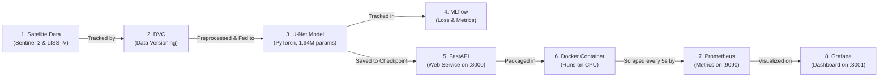

# Simplified Project Walkthrough & Guide Defense Cheat Sheet

**Project:** Generative AI-Based Cloud Removal for Satellite Imagery  
**Repository:** `liss4-cloud-removal`  
**Reading Time:** ~10–12 minutes  
**Goal:** Understand what you built, run the demo, and confidently answer your guide's questions without getting lost in technical jargon.

---

## 1. The Project in 30 Seconds

- **The Problem:** Clouds cover roughly two-thirds of the Earth. When optical satellites take photos, clouds block the view of farms, cities, and floods. Optical cameras cannot physically see through dense clouds.
- **Our Solution:** An end-to-end Machine Learning pipeline that takes a cloudy satellite image patch and uses a **U-Net neural network** to reconstruct (inpaint) the hidden ground surface using surrounding context.
- **The MLOps Stack:** 
  - **DVC** tracks large satellite data.
  - **MLflow** tracks training experiments.
  - **FastAPI** serves the model as a web API.
  - **Docker** packages everything into a portable container.
  - **Prometheus & Grafana** monitor real-time request rates, latency, and errors.
- **The Key Result:** The model achieves **38.94–40.00 dB PSNR** on Sentinel-2 validation data, cutting reconstruction error by **11.3x**.

---

## 2. What Did You Actually Build? (System Overview)

Here is how the entire project fits together in one simple picture:



---

## 3. The Dataset: What Was Used vs What Is Planned

This is the **#1 question** professors ask: *"Did you train on ISRO LISS-IV data?"*

Here is the exact truth you must state:

| Dataset | What It Is | How We Used It | Why It Matters |
| :--- | :--- | :--- | :--- |
| **SEN12MS-CR** | Global dataset of paired Sentinel-2 satellite photos ($10\text{ m}$ resolution, RGB). | **Used for Model Training & Testing.** 719 pairs total (575 train, 144 validation). | Provides real ground truth (a photo with clouds paired with a clear photo of the exact same spot days later). |
| **Resourcesat-2A LISS-IV** | Authentic Indian satellite product from ISRO / Bhoonidhi ($5\text{ m}$ resolution). | **Used for Data Engineering & Preprocessing.** Ingested, stacked 3 bands, and collar-masked using DVC. | **NOT used for model training yet.** |

### Why didn't we run the model on LISS-IV directly?
Be honest and proud of this answer—it shows real scientific maturity:
1. **LISS-IV has NO Blue band:** It has Green, Red, and Near-Infrared. Feeding Near-Infrared into a model trained on Blue causes vegetation to look totally distorted.
2. **Resolution mismatch:** LISS-IV is $5\text{ m}$ resolution ($2\times$ sharper than Sentinel-2's $10\text{ m}$).
3. **Missing calibration:** The ISRO product metadata lacks solar irradiance values ($ESUN$) needed to convert raw camera numbers into physical surface reflectance.
4. **No clear pair:** Our LISS-IV scene was taken during monsoon season and has no cloud-free photo to compare against.

---

## 4. The Deep Learning Model in Simple Terms

### What model is it?
A **Compact U-Net** implemented in PyTorch:
- **Parameter count:** **1.94 Million parameters** (small, fast, and runs easily on a regular laptop CPU without a GPU).
- **File size:** $23.4\text{ MB}$ (`checkpoints/compact/best_compact_unet.pt`).

### How does U-Net work?

```
Input: Cloudy RGB Image [3, 256, 256]
   │
   ▼
[ Encoder ]  ──(Compresses image to understand "what" is there)──┐
   │                                                              │ Skip Connections
   ▼                                                              │ (Bypasses bottleneck to
[ Bottleneck ]                                                    │  keep sharp ground details)
   │                                                              │
   ▼                                                              │
[ Decoder ]  ◄────────────────────────────────────────────────────┘
   │
   ▼
[ Sigmoid Layer ] ──► Guarantees output values are strictly in [0.0, 1.0]
   │
   ▼
Output: Reconstructed Clean Ground [3, 256, 256]
```

### Why U-Net instead of a GAN or Diffusion model?
1. **No "Hallucinations":** GANs often invent fake roads or trees that do not exist. In satellite imagery for disaster or farming, fake features are dangerous.
2. **Skip Connections:** Ground areas outside the cloud pass directly from encoder to decoder, preserving the exact original terrain.
3. **Speed & Stability:** U-Net trains stably with L1 loss and runs on CPU in $40\text{ ms}$, whereas Diffusion takes seconds per image.

---

## 5. The 3 Demo Commands (Run These in Front of Your Guide)

Open PowerShell in the project directory:

### Command 1: Run the Visual Cloud Removal Demo
```powershell
.venv\Scripts\python.exe demo.py
```
**What happens:**
- Loads the trained model (`best_compact_unet.pt`).
- Picks a real cloudy patch from the validation set (`p101`).
- Reconstructs the ground surface.
- Prints the quantitative improvement:
  - Input Cloudy MAE: `0.09086` $\to$ Prediction MAE: `0.00586`
  - Input PSNR: `17.68 dB` $\to$ Prediction PSNR: `41.59 dB` (**$+23.91\text{ dB}$ improvement!**)
- Saves a side-by-side comparison image to:  
  `reports/figures/demo_comparison.png`

👉 *Open that image on screen and show your guide the side-by-side: Cloudy Input | Predicted Ground | Actual Clear Ground.*

---

### Command 2: Prove All Automated Tests Pass
```powershell
.venv\Scripts\python.exe -m pytest -v
```
**What happens:**
- Runs all **87 automated tests** across the entire codebase.
- Tests API validation, U-Net math, collar masking, synthetic clouds, and Prometheus metrics.
- Shows: `87 passed in ~50s`.

---

### Command 3: Run the API & Monitoring Traffic Demo
```powershell
# In terminal, run:
.venv\Scripts\python.exe scripts/demo_monitoring.py --requests 10
```
**What happens:**
- Checks `/health` (liveness) and `/ready` (model readiness).
- Sends 10 real inference requests to `/predict`.
- Sends 3 invalid requests (e.g. wrong channels, bad numbers) to prove the API returns HTTP 422 error codes.
- Prints live Prometheus metrics directly in your terminal.

---

## 6. How the Deployment & Monitoring Works

### FastAPI Endpoints
- **`GET /health`:** Returns `200 OK` if the web server is running.
- **`GET /ready`:** Returns `200 OK` only if the U-Net model is loaded in memory and ready. (Returns `503` if model weights are missing).
- **`POST /predict`:** Accepts a 3D image patch `[3, Height, Width]`, verifies all values are between $0.0$ and $1.0$, and returns the reconstructed patch.
- **`GET /metrics`:** Exposes Prometheus metrics tracking request rates, errors, and millisecond latency.
- **`GET /docs`:** Interactive Swagger UI web page where anyone can test the API in their browser.

### Docker & Docker Compose
- **Dockerfile:** Builds a lightweight Debian-based container running on Python 3.11 with CPU-only PyTorch ($\approx 600\text{ MB}$).
- **Security:** Runs as an unprivileged user (`appuser`, not root).
- **Zero-Bake Principle:** Checkpoint weights are **not baked into the Docker image**. They are mounted read-only at runtime via `-v ./checkpoints/...:/models/checkpoint.pt:ro`.
- **Docker Compose:** Launches 3 containers at once:
  1. `api` (port 8000)
  2. `prometheus` (port 9090 - scrapes metrics every 5s)
  3. `grafana` (port 3001 - pre-loaded visual dashboard)

---

## 7. The 10 Most Common Questions Guide Will Ask & Exact Answers

### Q1: What is the main objective of your project?
> *"To build an end-to-end, reproducible MLOps pipeline for optical satellite cloud removal. We trained a U-Net model on Sentinel-2 optical benchmarks, containerized it with FastAPI and Docker, and instrumented it with Prometheus and Grafana for real-time monitoring."*

### Q2: Why can't optical satellites just use optical filters to remove clouds?
> *"Thick clouds cause severe Mie scattering. Optical light cannot pass through dense cloud droplets. Therefore, optical cloud removal is an inpainting and reconstruction problem where the neural network predicts the hidden surface based on surrounding clear terrain."*

### Q3: Did you train the model on LISS-IV?
> *"No, sir. We preprocessed and tracked authentic ISRO LISS-IV data with DVC, but our model was trained on Sentinel-2 RGB data. LISS-IV does not have a Blue band (it has Green, Red, and Near-Infrared), so feeding it into an RGB model would cause severe false-color distortion. We documented this cross-sensor limitation honestly rather than faking results."*

### Q4: Why U-Net instead of a GAN?
> *"U-Net is deterministic, trains stably, and doesn't hallucinate fake ground features. Its skip connections allow untouched clear areas outside the cloud to pass directly to the output without losing sharp resolution."*

### Q5: Why do you need both Git and DVC?
> *"Git is for code and text files. Satellite images are several gigabytes in size. Storing large images in Git slows down the repository and hits file limits. DVC tracks the multi-gigabyte satellite rasters in a local cache while Git only stores small text pointer files."*

### Q6: What does MLflow do in your project?
> *"MLflow acts as our experiment lab notebook. Every time we train, MLflow logs the hyperparameters (learning rate, batch size), the training curves, evaluation metrics (MAE and PSNR), and saves the resulting model checkpoint."*

### Q7: What is the difference between `/health` and `/ready`?
> *"`/health` is a liveness probe that checks if the web server process is alive. `/ready` is a readiness probe that checks if the model weights are actually loaded into memory. If the model file is missing, `/health` is 200 OK, but `/ready` returns 503 Service Unavailable so traffic isn't sent to a broken container."*

### Q8: Why does your API reject numbers greater than 1.0?
> *"Satellite surface reflectance is physically bounded between 0.0 and 1.0. If a user accidentally sends raw sensor digital numbers like 500 or 1000, our API rejects it with HTTP 422 instead of silently producing corrupted white images."*

### Q9: What do Prometheus and Grafana show?
> *"Prometheus scrapes our API every 5 seconds to record throughput, latency percentiles (p50, p95), and error codes. Grafana displays these metrics on a visual dashboard with green/red status indicators, request rate graphs, and latency curves."*

### Q10: What would you do next to make this work on real LISS-IV?
> *"Three steps: First, acquire a cloud-free LISS-IV scene from Bhoonidhi. Second, obtain solar irradiance tables from NRSC to calibrate raw digital numbers to surface reflectance. Third, train a dedicated False-Color U-Net using Sentinel-2's Green, Red, and Near-Infrared bands."*

---

## 8. Summary Table of Key Project Numbers

| Item | Exact Value | Where It Is in the Repo |
| :--- | :--- | :--- |
| **Model Parameters (Compact)** | **1,942,611** (~1.94M) | `src/cloud_removal/models/unet.py` |
| **Model Checkpoint Size** | **23.4 MB** (`best_compact_unet.pt`) | `checkpoints/compact/` |
| **Validation PSNR** | **38.94 dB – 40.00 dB** | `reports/compact_prototype_report.json` |
| **Validation MAE** | **0.00667** | MLflow Run `0f2e8b45bb024ec5bd6187d1d2a9d8aa` |
| **Error Reduction Factor** | **11.3x lower error** than raw input | `reports/compact_prototype_report.json` |
| **Total Automated Tests** | **87 passing tests** (0 failures) | `tests/` (run via `pytest`) |
| **ISRO LISS-IV Scene Size** | **18,066 x 16,223 pixels** (5m GSD) | `data/interim/stacked_product/manifest.json` |
| **FastAPI Port** | **Port 8000** | `docker-compose.yml`, `api.py` |
| **Prometheus Port** | **Port 9090** | `docker-compose.yml` |
| **Grafana Port** | **Port 3001** (admin / admin) | `docker-compose.yml` |

---

## 9. Presentation Script (What to Say When Showing the Project)

```text
"Good morning, Professor.

Our project addresses optical satellite data loss caused by cloud occlusion.
Because optical sensors cannot see through clouds, we built a complete MLOps 
pipeline that reconstructs surface reflectance using a U-Net neural network.

On the data side, we used DVC to track both genuine ISRO LISS-IV imagery and the 
global SEN12MS-CR benchmark dataset.

Our compact U-Net model has 1.94 million parameters and runs efficiently on CPU. 
On our validation holdout of 144 patches, it improved PSNR to 38.94 dB and cut 
reconstruction error by over 11 times.

We containerized the entire solution using FastAPI and Docker, enforcing strict 
data validation so invalid reflectance is rejected with HTTP 422 errors. 
Finally, we instrumented the service with Prometheus and Grafana to monitor 
request rates and p95 latency in real time.

When investigating ISRO's LISS-IV sensor, we found it lacks a Blue band and has 
twice the spatial resolution of Sentinel-2. Rather than forcing an unscientific 
band substitution, we documented these cross-sensor barriers rigorously, giving 
us a clear path for future False-Color and radar-optical fusion models.

I can now demonstrate the live cloud removal demo, run our 87 unit tests, or 
show the Grafana monitoring dashboard."
```
