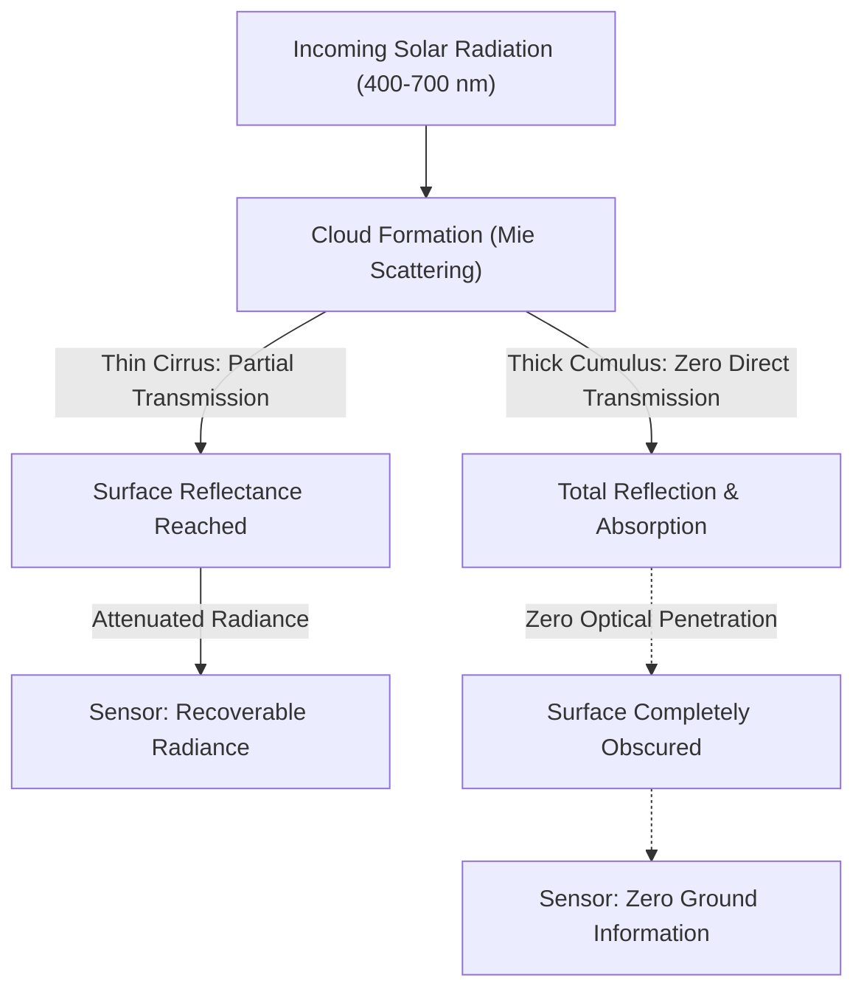

# Scientific, Sensor, and Operational Limitations

## 1. Optical Penetration Physics (The Fundamental Boundary)

Optical satellite sensors measure solar radiation reflected by the Earth's surface across the visible spectrum:
- **Blue**: $\approx 450 \text{ nm} - 510 \text{ nm}$
- **Green**: $\approx 530 \text{ nm} - 590 \text{ nm}$
- **Red**: $\approx 640 \text{ nm} - 670 \text{ nm}$

When clouds intercept incoming solar illumination or outgoing surface radiance, photons undergo extensive **Mie scattering** off suspended water droplets and ice crystals whose particle diameters ($2\,\mu\text{m} - 50\,\mu\text{m}$) are significantly larger than optical wavelengths.

### Scientific Implications for Single-Image Optical Models
1. **Partial Attenuation (Thin Cirrus)**: Under thin haze and semi-transparent clouds, residual high-frequency ground details transmit through to the sensor. Deep learning models can effectively de-haze and rebalance radiometric contrast.
2. **Total Attenuation (Dense Cumulus)**: Under dense, optically opaque clouds, **zero optical photons from the ground reach the sensor**.
3. **Estimation vs. Detection**: Any single-image optical model (including U-Net, ResNet, or GAN baselines) reconstructs obscured pixels by **spatial context synthesis** (hallucinating statistically plausible terrain based on neighboring unobscured landscape features). **It does not perform physical penetration.**

---

## 2. Temporal Offset in Ground-Truth Reference Imagery

In supervised remote-sensing cloud removal benchmarks (such as RICE2 and SEN12MS-CR), "ground truth" reference images are not acquired simultaneously with cloudy observations. They are captured on **adjacent clear-sky satellite revisits** (typically 5 to 16 days apart, or across seasonal cycles).

### Sources of Temporal Decorrelation
- **Agricultural Phenology**: A field captured as bare soil during a clear pass may have grown mature crops by the cloudy pass date.
- **Surface Hydrology**: Flash floods, soil moisture variations, and reservoir boundaries change between revisits.
- **Solar Zenith & Shadows**: Variations in sun elevation angle and azimuth alter the geometry and intensity of topographic and building shadows.
- **Evaluation Artifact**: When a model perfectly reconstructs the actual ground state beneath a cloud, it may still incur numerical penalties ($L_1$, MAE) if the reference image reflects an earlier or later phenological state.

---

## 3. Sensor Domain Gap: Why LISS-IV is Experimental

A core architectural conclusion of this project is that **Resourcesat-2A LISS-IV cannot be directly processed by models trained on standard optical RGB imagery without fine-tuning and paired calibration data**.

| Factor | Standard RGB Benchmark (RICE2 / Landsat / Sentinel-2) | ISRO Resourcesat-2A LISS-IV |
| :--- | :--- | :--- |
| **Spectral Bands** | Red (B04), Green (B03), Blue (B02) | **Green (B2), Red (B3), Near-Infrared (B4)** — *No Blue Band* |
| **Spatial Resolution** | 30m (Landsat) / 10m (Sentinel-2) | **5.0m GSD** |
| **Radiometric Units** | Standardized Top-of-Atmosphere (TOA) or Surface Reflectance $[0.0, 1.0]$ | **Raw Uncalibrated Digital Numbers (DN)** $[0, 1023]$ |
| **Data Pair Availability** | Established global archives of paired cloudy/clear scenes | **Mono-temporal monsoon pass from Bhoonidhi** (zero paired clear-sky reference) |

### The False-Color Composite (FCC) Dilemma
Mapping LISS-IV $[B2, B3, B4]$ into an RGB container produces a **False-Color Composite (FCC)** where vegetation appears deep red rather than green. Passing FCC imagery into an RGB-trained model introduces severe distribution shift: the convolutional kernels interpret high NIR reflectance as high Red reflectance, causing distorted reconstruction.

For these reasons, LISS-IV processing is documented in [`docs/future_work/liss4_roadmap.md`](file:///e:/Third%20Year%20(26-27)%20(Semester%201)/liss4-cloud-removal/docs/future_work/liss4_roadmap.md) as experimental and is disabled in the production inference service.

---

## 4. Operational Boundaries & Safety Boundaries

> [!WARNING]
> **Safety-Critical Prohibition**:
> The reconstructed outputs generated by this system are **statistical approximations**. They must **NOT** be used as primary data sources for:
> - Flood inundation or disaster relief routing.
> - Wildfire evacuation decision systems.
> - Legal boundary or property dispute adjudication.
> - Navigation or defense surveillance.

### Recommended Operational Practices
1. **Always Retain Cloudy Originals**: Downstream analysis systems must store both the raw cloudy raster and the reconstructed raster side-by-side.
2. **Inspect the Cloud Mask**: Use the generated cloud mask to identify which spatial zones represent true optical observations versus model-generated statistical reconstructions.
3. **Prefer Multi-Sensor Fusion**: For operational cloud penetration, multi-sensor architectures combining **Synthetic Aperture Radar (SAR / Sentinel-1 C-band)** with optical imagery should be utilized, as microwave radar signals physically penetrate atmospheric clouds.
