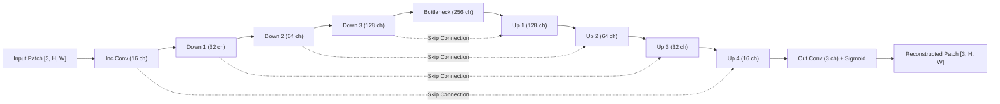

# Model Card: Compact U-Net Cloud Reconstruction Baseline (v1.0.0)

## 1. Model Overview

The **Compact U-Net Cloud Reconstruction Baseline** is a convolutional encoder-decoder neural network designed for deterministic optical surface reconstruction in cloud-obscured satellite imagery. It serves as the official production baseline for the Remote-Sensing Cloud Reconstruction project.

| Metadata Field | Specification |
| :--- | :--- |
| **Model Name** | Compact U-Net (Cloud Reconstruction Baseline) |
| **Model Version** | `1.0.0` |
| **Model Architecture** | 4-Level U-Net with Skip Connections and Residual Biasing |
| **Base Channels** | 16 (Channels: $16 \rightarrow 32 \rightarrow 64 \rightarrow 128 \rightarrow 256$ bottleneck) |
| **Parameter Count** | 1,939,123 trainable parameters (~1.94M) |
| **Checkpoint Path** | `checkpoints/rice2/best_rice2_compact_unet.pt` (~23.4 MB) |
| **Framework** | PyTorch 2.x |
| **Production Target** | Real-time, deterministic CPU & GPU inference |

---

## 2. Intended Use & Target Scope

### Primary Intended Use
- **Reconstruction of Cloud-Obscured Optical Surfaces**: Estimates clear-sky land and water surface reflectance beneath thin cirrus, moderate cloud formations, and cloud shadows in 3-band RGB satellite imagery.
- **Sensor Domain**: Standardized Landsat-8 OLI, Sentinel-2 MSI (B04-Red, B03-Green, B02-Blue), and Google Earth optical surface reflectance tiles.
- **Production Serving**: Real-time batch and windowed tiled raster processing via FastAPI and interactive Web UI.

### Out-of-Scope & Unsupported Use Cases
- **Uncalibrated Raw Sensors**: Direct inference on uncalibrated raw Digital Numbers (DNs) without atmospheric correction.
- **Mono-band / Non-RGB Imagery**: Single-band grayscale rasters or non-RGB multi-spectral bands (e.g., SWIR, Thermal).
- **Safety-Critical / Emergency Routing**: The model generates a **plausible statistical surface estimate** conditioned on surrounding optical context; it cannot penetrate optically opaque thick cumulus clouds and must not be used for emergency navigation, fire dispatch, or flood evacuation routing without multi-temporal ground validation.

---

## 3. Architecture Details

The model utilizes a streamlined U-Net architecture optimized for high-throughput execution with bounded memory footprint:



- **Output Activation**: Final layer incorporates a bounded `Sigmoid` activation enforcing physical reflectance limits $y \in [0.0, 1.0]$.
- **Prior Reflectance Bias**: Convolutional output biases are initialized to a typical continental surface reflectance prior ($\approx 0.107$) to accelerate early convergence.

---

## 4. Training Configuration & Hyperparameters

The model was trained on the official RICE2 training partition ($N=471$ scenes) using deterministic seed initialization:

| Parameter | Configuration |
| :--- | :--- |
| **Optimization Algorithm** | Adam ($\beta_1 = 0.9, \beta_2 = 0.999, \epsilon = 1 \times 10^{-8}$) |
| **Weight Decay** | $1 \times 10^{-5}$ (L2 regularization) |
| **Initial Learning Rate** | $2 \times 10^{-4}$ |
| **Batch Size** | 4 paired samples per batch |
| **Learning Rate Schedule** | `CosineAnnealingLR` ($T_{\max} = 30$, $\eta_{\min} = 1 \times 10^{-6}$) |
| **Early Stopping** | Monitored: `val_mae`, Patience: 5 epochs, Min Delta: $1 \times 10^{-4}$ |
| **Random Seed** | Fixed seed `42` (Python, NumPy, PyTorch CPU/CUDA, worker seeds) |
| **Loss Function** | Compound $L_1$ + Structural Similarity Loss: |

$$\mathcal{L}(y, \hat{y}) = \|y - \hat{y}\|_1 + \lambda_{\text{ssim}} \cdot (1 - \text{SSIM}(y, \hat{y})), \quad \text{where } \lambda_{\text{ssim}} = 0.2$$

---

## 5. Performance & Quantitative Evaluation

Performance evaluated on the strictly held-out RICE2 test split ($N = 148$ samples, $512 \times 512$ resolution):

### Global Evaluation (All Pixels)

| Metric | Cloudy Input Baseline | Compact U-Net Baseline | Improvement |
| :--- | :---: | :---: | :---: |
| **Mean Absolute Error (MAE)** | 0.0650 | **0.0491** | **-24.4% error** |
| **Peak Signal-to-Noise Ratio (PSNR)** | 23.33 dB | **25.12 dB** | **+1.79 dB** |
| **Structural Similarity Index (SSIM)** | 0.8029 | **0.8510** | **+0.0481** |

### Cloud-Region Targeted Evaluation (Obscured Pixels Only)

| Metric | Cloudy Baseline (Masked) | Compact U-Net (Masked) | Improvement |
| :--- | :---: | :---: | :---: |
| **Cloud-Region MAE** | 0.1294 | **0.0604** | **-53.3% error reduction** |
| **Cloud-Region PSNR** | 17.51 dB | **23.27 dB** | **+5.76 dB gain** |

---

## 6. Checkpoint Provenance & Reproducibility

Every saved checkpoint (`checkpoints/rice2/best_rice2_compact_unet.pt`) contains immutable provenance records embedded inside the weight file:

```python
{
    "architecture": "Compact U-Net (16 base channels)",
    "git_commit": "10aabde516818762a16d08688bf5cad350076fc1",
    "manifest_sha256": "f302fbc8e0a7d3d88763b34a41f5f39ad9a26a4aba89fc7f9356212fb8850ad9",
    "config_sha256": "55423879e0b8f00d668f8e71610512ef0d1c323236b566d64776c13515ae3a0d",
    "training_seed": 42,
    "epoch": 20,
    "val_mae": 0.048165,
    "val_psnr": 25.43
}
```

This guarantees end-to-end traceability from the active model binary back to the exact Git commit, dataset manifest, and training configuration.
