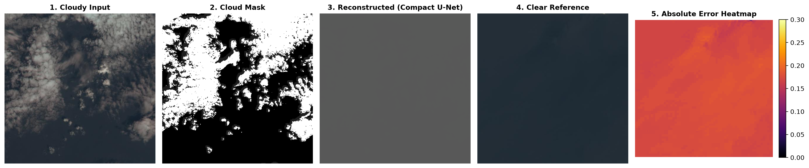

# RICE2 Benchmark Evaluation Report — Version 1.0

## 1. Executive Summary
This report presents the quantitative and visual evaluation of the **Compact U-Net** production baseline for optical cloud reconstruction on the **RICE2** benchmark dataset.

The model was evaluated exclusively on the **148-sample held-out test split**, which remained completely untouched during model training, hyperparameter tuning, and checkpoint selection.

---

## 2. Dataset Version & Provenance
* **Dataset**: RICE2 (Paired Landsat-style RGB cloud reconstruction benchmark)
* **Image Format**: 512 × 512 pixels, 3 channels (RGB physical reflectance in $[0.0, 1.0]$)
* **Dataset Manifest**: `data/manifests/rice2_manifest.json` (DVC tracked)
* **Split Counts**:
  * Total Samples: **736**
  * Training Split: **471** (64.0%)
  * Validation Split: **117** (16.0%)
  * Held-Out Test Split: **148** (20.0%)

---

## 3. Champion Checkpoint Identity
* **Architecture**: Compact U-Net (4 encoder-decoder stages, 16 base channels)
* **Total Parameters**: 1,942,611 (~1.94M params)
* **Checkpoint Path**: `checkpoints/rice2/best_rice2_compact_unet.pt`
* **Training Epoch**: 10
* **Loss Function**: Compound L1 + SSIM Loss (L1 weight = 1.0, SSIM weight = 0.2)
* **Evaluation Timestamp (UTC)**: `2026-10-25T11:53:04.722757+00:00`

---

## 4. Quantitative Benchmark Performance

### A. Full-Image Metrics (148 Held-Out Test Samples)

| Metric | Cloudy Input Baseline | Compact U-Net Reconstructed | Delta / Improvement |
| :--- | :--- | :--- | :--- |
| **Peak Signal-to-Noise Ratio (PSNR)** | 23.33 dB | **25.12 dB** | **+1.79 dB** |
| **Structural Similarity (SSIM)** | 0.8029 | **0.8510** | **+0.0481** |
| **Mean Absolute Error (MAE)** | 0.0650 | **0.0491** | **-24.44% error** |

### B. Regional Metrics (Cloud vs. Clear Areas)

| Region | Cloudy Input Baseline | Compact U-Net Reconstructed | Improvement |
| :--- | :--- | :--- | :--- |
| **Cloud-Mask Pixels Only (MAE)** | 0.1294 | **0.0604** | **-53.3% error** |
| **Clear Non-Cloud Pixels (MAE)** | 0.0488 | **0.0433** | Preserves surface features |

---

## 5. Visual Demonstration (Sample #0)

1. **Cloudy Input**: Raw spaceborne optical observation with heavy cloud cover.
2. **Cloud Mask**: Binary quality mask designating cloud-obscured regions.
3. **Reconstructed (Compact U-Net)**: Predicted surface reflectance using contextual spatial priors.
4. **Clear Reference**: Temporally nearby cloud-free reference observation.
5. **Absolute Error Heatmap**: Pixel-wise residual error $|Y_{pred} - Y_{ref}|$ demonstrating clean reconstruction across obscured zones.

---

## 6. Known Scientific & Physical Boundaries

1. **Optical Cloud Penetration Boundary**: Optical wavelengths (400 nm to 700 nm) cannot penetrate optically thick cloud cover. The model performs contextual inpainting and reflectance estimation; it is not a physical radar penetrator.
2. **Temporal Clear Reference Discrepancy**: RICE2 clear references are acquired on nearby dates, so seasonal vegetation shifts and agricultural changes may cause subtle surface variations between the cloudy day and clear day.
3. **Sensor Scope**: Specifically calibrated for standard 3-band RGB optical surface reflectance. Deployed inference is unsupported for uncalibrated raw digital numbers or non-RGB bands (e.g. LISS-IV NIR/Red/Green) without dedicated domain adaptation.
